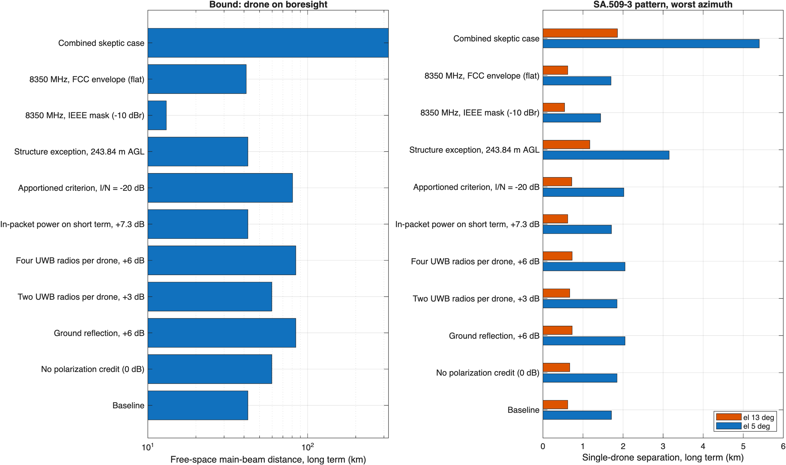

```
DRAFT - PRE-DECISIONAL AND DELIBERATIVE
Prepared with AI assistance. Reviewer: [CONFIRM]
Rule text as of: 2026-11-07
Public and cleared sources only.
```

# Purpose

This paper lists every assumption behind the UWB channel 9 analysis in the companion working paper, *UWB Channel 9 Drones and Federal Space-to-Earth Receivers in 7737.6-8236.8 MHz* (Rev 0). For each assumption it gives the value used, the source with a link, how the analysis uses it, how much the result depends on it, and a question that NASA, NOAA, or USGS can answer to confirm or correct it.

The second half reviews the analysis from the point of view of a skeptical NASA spectrum engineer. It lists the gaps that reviewer would raise, quantifies the ones the model can test, and flags the ones it can't.

All code is in [`nicklasorte/7GHz_UWB_NRPM`](https://github.com/nicklasorte/7GHz_UWB_NRPM) at commit `{SHA}`. Every input is set in [`uwb_eess_params_rev1.m`]({BASE}/matlab/uwb_eess_params_rev1.m) or [`victim_systems_rev2.m`]({BASE}/matlab/victim_systems_rev2.m).

# How to read the register

Each row has a status:

- **Sourced**: taken from the linked document.
- **Derived**: calculated from sourced values; the derivation is shown.
- **Assumed**: an engineering judgment with no authoritative source; the sensitivity column shows how much it matters.
- **Open**: needed but not available from public sources; the analysis runs without it or with a placeholder.

The sensitivity column states the change in the link margin in decibels. Free-space distance scales by a factor of 10^(dB/20): +3 dB is a factor of 1.41, +6 dB is 2.0, and +10 dB is 3.2.

# Assumptions register

## Regulatory and operational

| ID | Assumption | Value | Status | Source | Sensitivity | Question for NASA |
| --- | --- | --- | --- | --- | --- | --- |
| R1 | UWB drones would operate at the handheld average limit | -41.3 dBm/MHz EIRP | Sourced | [47 CFR 15.519(c)](https://www.law.cornell.edu/cfr/text/47/15.519) | 1:1 in dB | None |
| R2 | The FCC might allow airborne UWB | Proposal under consideration | Sourced | [ET Docket No. 26-245 NPRM, paras. 22, 28-30](https://docs.fcc.gov/public/attachments/DOC-424842A1.pdf) | Scope of the problem | None |
| R3 | Highest drone altitude | 121.92 m (400 ft) AGL | Sourced | [14 CFR 107.51(b)](https://www.law.cornell.edu/cfr/text/14/107.51) | Sets the boresight ring: 1.28 km at 5° | Are there waivered or Part 107.51 structure-exception flights near your sites? |
| R4 | Lowest drone altitude | 10 m AGL | Assumed | None | Small; affects only near-in aggregate | None |
| R5 | Drone density near earth stations | Swept, 0.001 to 1 active drones per km² | Open | None | About 1:1 in dB for the aggregate | Do you know of drone operations near AS1, WG1, or EROS? |
| R6 | Duty cycle for a new UWB category | Under 1% per 24 hours (proposed) | Sourced | [NPRM paras. 37-38](https://docs.fcc.gov/public/attachments/DOC-424842A1.pdf) | Could reduce aggregate by 20 dB or more, if applied to drones | None |
| R7 | European aircraft UWB limit in 7.75-7.9 GHz below 1000 m | -64.3 dBm/MHz | Sourced | [ECC Decision (12)03](https://docdb.cept.org/download/1522) | Reference point only | None |

## UWB emission

| ID | Assumption | Value | Status | Source | Sensitivity | Question for NASA |
| --- | --- | --- | --- | --- | --- | --- |
| U1 | Channel 9 center and bandwidth | 7987.2 MHz, 499.2 MHz | Sourced | [IEEE 802.15.4 overview, arXiv 2202.02190](https://arxiv.org/pdf/2202.02190); NPRM fn. 63 | Sets overlap | None |
| U2 | Transmit PSD mask | 0 dBr to ±324.5 MHz; -10 dBr to ±399.4 MHz; -18 dBr beyond | Sourced, breakpoints [CONFIRM] | IEEE 802.15.4 HRP; [Keysight mask page](https://helpfiles.keysight.com/csg/89600B/Webhelp/Subsystems/hrpuwb/content/trc_transmit_mask.htm) | -10 dB at 8350 MHz (13.1 km vs 41.3 km main-beam distance) | None |
| U3 | Emission spectrum is continuous, not line | Scrambled HRP pulses | Sourced | [NTIA Report 01-383, sec. 3.2](https://www.its.ntia.gov/publications/download/TR-01-383.pdf) | Line spectra would concentrate power | None |
| U4 | Average measured as RMS over 1 ms or less | 1 ms | Sourced | 47 CFR 15.521(d) ([archived text](https://ziggy.hallikainen.org/org/FCC/FccRules/2013/15/521)) | Allows in-packet power above the average | None |
| U5 | In-packet power boost | Up to 7.3 dB | Derived | 15.521(g) peak in 1 MHz = 20 log(1/50) = -34.0 dBm, less -41.3 dBm | Short-term distance x2.3 | None |
| U6 | Peak envelope in bandwidth B | 20 log(B/50) dBm | Sourced for 1-50 MHz; extrapolated above | [47 CFR 15.521(g)](https://ziggy.hallikainen.org/org/FCC/FccRules/2013/15/521) | Allowed peak-to-average of 33 dB in 375 MHz | Do your demodulators have pulsed-interference tolerance data? |
| U7 | Mean PRF | 62.4 MHz (BPRF); 124.8, 249.6 MHz (HPRF) | Sourced | [MathWorks `lrwpanHRPConfig`](https://www.mathworks.com/help/comm/ref/lrwpanhrpconfig.html) | Decides noise-like vs pulse-resolved | None |
| U8 | Packet on-time | 0.1-1 ms, swept | Assumed | None | Sets in-packet boost (0-7.3 dB) | None |
| U9 | Activity factor | 0.25%-5% for ground applications | Sourced, not for drones | ECC Report 327 Table 18 via [FiRa (2025)](https://www.firaconsortium.org/sites/default/files/2025-11/FiRa%20Ultra-Wideband%20Simulation%20Report.pdf) | Long-term aggregate 1:1 | None |
| U10 | UWB antenna pattern | Isotropic at the EIRP limit | Assumed | None | 0 dB here; a downward pattern could subtract several dB at low elevation | None |
| U11 | UWB radios per drone | One | Assumed | ECC Report 175 assumed two per aircraft ([docdb 674](https://docdb.cept.org/download/674)) | +3 dB (two), +6 dB (four) | None |
| U12 | Polarization loss into the earth station feed | 3 dB (linear into circular) | Derived | cos²(45°) | 3 dB | Is each feed circular? (NEN lists RHC/LHC) |

## Victim systems

| ID | Assumption | Value | Status | Source | Sensitivity | Question for NASA |
| --- | --- | --- | --- | --- | --- | --- |
| V1 | NEN AS1 (Fairbanks) and WG1 (Wallops) X-band receive band | 8025-8500 MHz (AS1); 8000-8500 MHz (WG1) | Sourced | [NEN Users' Guide, 453-NENUG Rev 5, Table 2-1](https://ntrs.nasa.gov/api/citations/20205005784/downloads/453NENUGRev5__clean_final_82420.pdf) | Confirms full overlap with the ch 9 EESS segment | None |
| V2 | NEN AS1 and WG1 G/T | 35.2 and 34.5 dB/K at 10° elevation | Sourced | NEN Users' Guide Table 2-1 | Sets Tsys and I/N criteria | What is G/T at 5°, and in which bandwidth? |
| V3 | NEN 11.3 m X-band gain and beamwidth | 57.5 dBi; 0.2° typical | Sourced for SG1 (11.3 m); applied to AS1 and WG1 | NEN Users' Guide Table 3-3 | ±0.5 dB | Please confirm for AS1 and WG1 |
| V4 | ITU-R SA.509-3 G0 with 60% efficiency | 57.48 dBi; 3 dB beamwidth 0.225° | Derived | [ITU-R SA.509-3, sec. 1.3](https://itu.int/dms_pubrec/itu-r/rec/sa/R-REC-SA.509-3-201312-I!!PDF-E.pdf) | Agrees with V3 within 0.02 dB | None |
| V5 | NEN system noise temperature | 170 K (AS1), 200 K (WG1) | Derived | G0 - G/T from V2 and V3 | Affects only I/N-based criteria | Please provide Tsys at 5° and 10° |
| V6 | NEN receiver bandwidth | Not modeled; criteria in 10 MHz | Open | NEN Users' Guide lists rates up to 320 Mbps | Wider receivers collect more UWB power and may resolve pulses | Please provide IF bandwidth per mission |
| V7 | Off-axis antenna pattern | ITU-R SA.509-3 single-entry (one drone) and multiple-entry (aggregate) envelopes | Sourced | [ITU-R SA.509-3](https://itu.int/dms_pubrec/itu-r/rec/sa/R-REC-SA.509-3-201312-I!!PDF-E.pdf) | Multiple-entry pattern is 3 dB below single-entry | Do measured patterns exist for AS1 and WG1? |
| V8 | Dish center height | 10 m above local ground | Assumed | None | Moves the boresight ring by about 0.1 km | Please provide |
| V9 | Minimum operational elevation | 5° | Sourced | [ITU-R SA.1026-5](https://itu.int/dms_pubrec/itu-r/rec/sa/R-REC-SA.1026-5-201707-I!!PDF-E.pdf) | 3° would extend the boresight ring to about 2.1 km | Do any passes track below 5°? What are the horizon masks? |
| V10 | Site shielding | 0 dB | Assumed | None | Could remove low-elevation exposure | Do fences, buildings, or terrain shield the antennas? |
| V11 | JPSS HRD terminal | 7812 MHz; 30 MHz; 3 m; G/T 22.7 dB/K at 5°; Eb/N0 4.4 dB; 1 dB margin | Sourced | [JPSS-1 HRD-DBS RF ICD Rev A](https://www.nesdis.noaa.gov/s3/2022-03/JPSS-1SCHRDtoDBSRFICDRevA-470-REF-00184February9,2015.pdf) | Reference terminal | NOAA: where are U.S. HRD terminals? |
| V12 | JPSS HRD Tsys | 194 K | Derived | G0 (45.6 dBi at 60% efficiency) - G/T | I/N distances | None |
| V13 | Landsat 8/9 receiver | 375 MHz; 384 Mbps; rate-7/8 LDPC; 10 m at EROS | Sourced | [USGS](https://www.usgs.gov/landsat-missions/landsat-data-space-earth); [USGS pub 70193004](https://pubs.usgs.gov/publication/70193004) | Wide receiver resolves pulses | USGS: G/T, Tsys, required Eb/N0, radome loss |

## Propagation and geometry

| ID | Assumption | Value | Status | Source | Sensitivity | Question for NASA |
| --- | --- | --- | --- | --- | --- | --- |
| P1 | Free-space loss on LOS paths | 20 log(4 pi d / lambda) | Sourced | MATLAB `fspl` | Baseline | None |
| P2 | No ground reflection | 0 dB | Assumed | None | Up to +6 dB with constructive reflection | None |
| P3 | Effective Earth radius factor | 4/3 | Sourced | ITU-R P.452 median | Small at these ranges | None |
| P4 | Paths beyond the radio horizon | Dropped | Assumed | None | Optimistic only for drones near the 58.5 km horizon | None |
| P5 | Flat ground at a common elevation | Yes | Assumed | None | Terrain can raise or block drones | Use ITM with terrain at each site |
| P6 | Far-field antenna gain at all distances | G0 at every range | Assumed | None | Overstates coupling inside the far-field distance (2D²/lambda = 7.0 km for 11.3 m, 5.5 km for 10 m, 0.5 km for 3 m) | Near-field gain data for close drones |

## Protection criteria

| ID | Assumption | Value | Status | Source | Sensitivity | Question for NASA |
| --- | --- | --- | --- | --- | --- | --- |
| C1 | EESS long-term criterion | -150 dBW per 10 MHz, 20% of time (terrestrial paths) | Sourced | [ITU-R SA.1027-6, Table 1](https://www.itu.int/dms_pubrec/itu-r/rec/sa/R-REC-SA.1027-6-201908-I!!PDF-E.pdf) | 1:1 in dB | Do you accept SA.1027-6 for UWB? |
| C2 | EESS short-term criterion | -133 dBW per 10 MHz, 0.005% of time | Sourced | ITU-R SA.1027-6, Table 1 | 1:1 in dB | Same |
| C3 | MetSat criteria | -144 dBW (20%), -127 dBW (0.0125%) per 10 MHz | Sourced | ITU-R SA.1026-5, Table 1 | 1:1 in dB | NOAA: same question |
| C4 | Long- and short-term pointing elevations | 13° and 5° | Sourced | ITU-R SA.1026-5, Table 2 | Short-term at 5° governs | None |
| C5 | UWB may use the full terrestrial share | Yes | Assumed | None | An I/N = -20 dB apportionment is 5.6 dB stricter at WG1 | What apportionment would you require for UWB? |
| C6 | Average-power criteria cover pulsed interference | Yes | Assumed | ITU-R SA.1027-6 states average power only | Unknown; needs measurement | See U6 |

## Monte Carlo

| ID | Assumption | Value | Status | Source | Sensitivity | Question for NASA |
| --- | --- | --- | --- | --- | --- | --- |
| M1 | Drone locations | Poisson in number, uniform in area to the horizon | Assumed | None | Real drones cluster near launch sites | None |
| M2 | Dish azimuth | Uniform | Assumed | None | Real passes favor certain azimuths at high latitude | Pass azimuth statistics |
| M3 | Iterations | 20,000 (long); 200,000 (short) | Derived | About 10 samples beyond the 0.005% point | Resolves the short-term tail | None |
| M4 | Active density combines density and activity | Poisson thinning | Derived | Poisson property | None | None |

# Red-team review from a skeptical NASA perspective

## Quantified sensitivities

[`red_team_sensitivity_rev1.m`]({BASE}/matlab/red_team_sensitivity_rev1.m) reruns the analysis for NEN WG1 (Wallops: 57.5 dBi, 34.5 dB/K, 200 K) with one assumption changed at a time. The single-drone separation uses the SA.509-3 single-entry pattern with the drone in the dish azimuth.

| Case | Margin change | Main-beam distance, long term | Main-beam distance, short term | Single-drone separation, 5° | Single-drone separation, 13° | Boresight ring, 5° |
| --- | --- | --- | --- | --- | --- | --- |
| Baseline | 0 dB | 42.3 km | 6.0 km | 1.71 km | 0.62 km | 1.28 km |
| No polarization credit | +3 dB | 59.7 km | 8.4 km | 1.85 km | 0.67 km | 1.28 km |
| Ground reflection | +6 dB | 84.3 km | 11.9 km | 2.05 km | 0.73 km | 1.28 km |
| Two UWB radios per drone | +3 dB | 59.7 km | 8.4 km | 1.85 km | 0.67 km | 1.28 km |
| Four UWB radios per drone | +6 dB | 84.3 km | 11.9 km | 2.05 km | 0.73 km | 1.28 km |
| In-packet power on the short-term test | +7.3 dB (short term) | 42.3 km | 13.9 km | 1.71 km | 0.62 km | 1.28 km |
| Apportioned criterion, I/N = -20 dB | +5.6 dB | 80.5 km | 6.0 km | 2.02 km | 0.72 km | 1.28 km |
| Structure exception, 243.84 m AGL | 0 dB | 42.3 km | 6.0 km | 3.15 km | 1.17 km | 2.67 km |
| 8350 MHz, IEEE mask | -10 dB | 13.1 km | 1.8 km | 1.44 km | 0.54 km | 1.28 km |
| 8350 MHz, FCC envelope | 0 dB | 41.3 km | 5.8 km | 1.70 km | 0.62 km | 1.28 km |
| Combined skeptic case (0 dB polarization, +6 dB reflection, two radios, I/N = -20 dB, in-packet, 243.84 m) | +17.6 dB | 320.5 km | 55.2 km | 5.40 km | 1.86 km | 2.67 km |

Main-beam distances beyond the 58.5 km radio horizon (77 km for a 243.84 m drone) are bounds only; the drone can't be on boresight there.



## Gaps and holes NASA would raise

Each item states the objection, what the analysis does now, and what would close it.

### Site-specific drone exposure

1. **Drone test ranges next to NEN antennas.** Wallops hosts the MARS UAS airfield on Wallops Island, a 3,000 ft runway with access to 75 square nautical miles of restricted airspace with no altitude limit ([unmanned-aerial.com, May 2017](https://unmanned-aerial.com/virginia-cuts-ribbon-3000-foot-uas-runway)). Fairbanks, where AS1 sits, is home to the FAA UAS test site run by the University of Alaska Fairbanks Alaska Center for UAS Integration, which holds a broad FAA waiver for research flights ([UAF, February 2023](https://www.uaf.edu/news/archives/2023/faa-grants-wide-authority-to-uaf-unmanned-aircraft-center.php)). The 400 ft ceiling (R3) doesn't hold in restricted airspace, and any UWB-equipped test aircraft above 400 ft extends boresight coupling toward the main-beam distances. *Close it:* rerun at each site with the actual airspace and a drone altitude distribution from the range operators.
2. **The 107.51 structure exception.** Drones may fly 400 ft above a structure within 400 ft of it. A drone inspecting a tower near a dish can be at 243.84 m or higher, which doubles the boresight ring to 2.67 km and the single-drone separation to 3.15 km. *Close it:* inventory tall structures within 5 km of each site.
3. **Fixed UWB anchors for drone landing.** The NPRM asks about installations up to 20 m for low-altitude drone operations (para. 44). Landing-pad anchors transmit continuously relative to a drone flight and don't move, so the long-term criterion applies directly, not through an activity factor. The analysis doesn't model fixed anchors. *Close it:* add a fixed-transmitter case with ground-level clutter.

### UWB emission

4. **Activity factor for navigation.** The ground activity factors in U9 assume intermittent ranging. A drone that navigates or lands by UWB may range continuously while flying, which makes activity close to 100% during flight. *Close it:* get duty-cycle data for UWB navigation and landing systems from NPRM commenters.
5. **More than one radio per drone.** Navigation designs can use several radios for redundancy or angle of arrival. Two radios add 3 dB and four add 6 dB.
6. **Out-of-channel and adjacent-channel emissions.** The IEEE mask is a device design target, not a regulatory limit. The FCC envelope allows -41.3 dBm/MHz across 3.1-10.6 GHz, so a device on channel 9 may emit at full level up to 8400 MHz. UWB channel 10 (centered at 8486.4 MHz [CONFIRM]) would put 8236.8-8400 MHz in-channel. A channel restriction would need to cover channel 10 as well.
7. **Peak and burst effects on demodulators.** ITU-R criteria are average power. Wideband receivers (Landsat at 375 MHz; NEN at up to 320 Mbps) resolve individual pulses or bursts, and the rules allow up to 33 dB peak-to-average in 375 MHz. Rate-7/8 LDPC links have little coding margin against impulsive interference. *Close it:* bench-test an 802.15.4z channel 9 emission through the NEN and Landsat demodulators, ideally with NTIA ITS (NPRM fn. 40).

### Victim parameters

8. **Low-elevation tracking.** The analysis stops at 5°. High-latitude stations may track below 5° to catch more passes, and each degree lower moves the boresight ring outward (3° extends it to about 2.1 km). *Close it:* NASA horizon masks for AS1 and WG1.
9. **Radome and receiver details.** NEN G/T values include the radome (Table 3-3 notes). A radome doesn't change the interference-to-signal ratio, but the receiver bandwidth and actual Tsys at 5° do change I/N.
10. **SA.509-3 envelopes are not measured patterns.** Real near sidelobes can exceed the envelope at specific angles. The aggregate uses the multiple-entry pattern, 3 dB below the single-entry envelope; NASA may prefer the single-entry envelope for drones near the main beam.

### Criteria and apportionment

11. **UWB shouldn't take the whole terrestrial share.** SA.1027-6 sets one budget for all terrestrial sources. The fixed service is co-primary at 8025-8400 MHz and handheld and vehicle UWB already exist. An apportioned criterion such as I/N = -20 dB for UWB is 5.6 dB stricter at WG1. [CONFIRM: an authoritative source for a UWB apportionment value.]
12. **Aggregate of all UWB sources, not drones alone.** The Monte Carlo counts only drones. Ground UWB (handheld, vehicles, infrastructure) near an earth station adds to the same budget.

### Method

13. **Pointing statistics.** The 13° and 5° pointing values come from SA.1026-5. Real LEO passes spend a large share of time at low elevation, so the fraction of time a dish looks toward low-flying drones may exceed what fixed pointing implies. *Close it:* compute pass elevation statistics for Aqua, Terra, and Landsat at each site.
14. **Ground reflections.** Over flat, open ground near a dish, a specular reflection can add up to 6 dB. The analysis assumes none.
15. **Clustering.** Real drones cluster near launch sites, ports, and test ranges. Uniform placement understates exposure near a cluster and overstates it elsewhere.

### Holes that cut the other way

A credible review also states the assumptions that make the analysis conservative. NASA reviewers should expect commenters to raise these:

- **Near-field gain.** The far-field distance is 7.0 km for an 11.3 m antenna at 8160 MHz. Drones inside the 1.28 km boresight ring are in the near field, where on-axis gain is below G0. The analysis applies G0 at every range, which overstates close-in coupling.
- **Isotropic UWB antenna at the limit.** Real devices rarely radiate the maximum EIRP toward the horizon.
- **Free-space loss to 58.5 km.** Terrain, buildings, and vegetation add loss on most real paths.
- **Fixed worst-case azimuth for the single drone.** A drone stays in the dish azimuth only briefly during a pass.

# Questions for NASA, NOAA, and USGS

1. For AS1 and WG1: G/T and Tsys at 5°, receiver IF bandwidth by mission, antenna height, horizon mask, and measured antenna patterns.
2. Minimum tracking elevation and pass elevation statistics for Aqua, Terra, Aura, and Landsat.
3. Required Eb/N0 and link margin for each mission's X-band downlink.
4. Any measured tolerance of the NEN and Landsat demodulators to pulsed or bursty interference.
5. Drone activity near AS1, WG1, and EROS, including the Wallops MARS UAS airfield and the Fairbanks UAS test site.
6. Whether NASA accepts ITU-R SA.1027-6 terrestrial criteria for UWB, or would require an apportioned value.
7. For NOAA: locations and antenna heights of U.S. JPSS HRD terminals.

# Sources

Regulatory

- FCC, *Modernization of Ultra-Wideband Technology Rules*, NPRM, ET Docket No. 26-245 (rel. Oct. 1, 2026), [circulation draft DOC-424842A1](https://docs.fcc.gov/public/attachments/DOC-424842A1.pdf)
- [Latham & Watkins summary of the NPRM](https://www.lw.com/en/insights/fcc-proposes-uwb-rules-overhaul-that-could-broaden-use-for-drones)
- [47 CFR 15.519](https://www.law.cornell.edu/cfr/text/47/15.519); [47 CFR 15.521 (archived text)](https://ziggy.hallikainen.org/org/FCC/FccRules/2013/15/521)
- [14 CFR 107.51](https://www.law.cornell.edu/cfr/text/14/107.51)
- [ECC Decision (12)03](https://docdb.cept.org/download/1522); [ECC Report 175](https://docdb.cept.org/download/674); [ECC/DEC/(06)04 related](https://docdb.cept.org/download/3045)

Victim systems

- NASA, [Near Earth Network Users' Guide, 453-NENUG Rev 5 (2020)](https://ntrs.nasa.gov/api/citations/20205005784/downloads/453NENUGRev5__clean_final_82420.pdf)
- [JPSS-1 HRD-DBS RF ICD Rev A (2015)](https://www.nesdis.noaa.gov/s3/2022-03/JPSS-1SCHRDtoDBSRFICDRevA-470-REF-00184February9,2015.pdf); [NOAA OSPO High Rate Data](https://ospo.noaa.gov/operations/jpss/high-rate-data.html)
- [USGS, Landsat data from space to Earth](https://www.usgs.gov/landsat-missions/landsat-data-space-earth); [USGS publication 70193004](https://pubs.usgs.gov/publication/70193004)
- NTIA, [Spectrum Needs of U.S. Space-based Operations, Appendix (2021)](https://www.ntia.gov/sites/default/files/publications/appendix-allocationsandsystems_0.pdf)

Criteria and methods

- [ITU-R SA.1026-5](https://itu.int/dms_pubrec/itu-r/rec/sa/R-REC-SA.1026-5-201707-I!!PDF-E.pdf); [ITU-R SA.1027-6](https://www.itu.int/dms_pubrec/itu-r/rec/sa/R-REC-SA.1027-6-201908-I!!PDF-E.pdf); [ITU-R SA.509-3](https://itu.int/dms_pubrec/itu-r/rec/sa/R-REC-SA.509-3-201312-I!!PDF-E.pdf); [ITU-R SM.337](https://www.itu.int/rec/R-REC-SM.337/en)
- [NTIA Report 01-383](https://www.its.ntia.gov/publications/download/TR-01-383.pdf); [NTIA SP 01-43](https://www.ntia.gov/report/2001/assessment-compatibility-between-ultrawideband-devices-and-selected-federal-systems)
- [Report ITU-R SM.2057](https://www.itu.int/dms_pub/itu-r/opb/rep/R-REP-SM.2057-2005-TOC-HTM-E.htm); [ITU-R SM.1757](https://www.itu.int/rec/R-REC-SM.1757/en)
- [FiRa Consortium UWB Simulation Report (2025)](https://www.firaconsortium.org/sites/default/files/2025-11/FiRa%20Ultra-Wideband%20Simulation%20Report.pdf)
- [MathWorks `lrwpanHRPConfig`](https://www.mathworks.com/help/comm/ref/lrwpanhrpconfig.html); [IEEE 802.15.4 overview](https://arxiv.org/pdf/2202.02190)

Drone activity near sites

- [MARS UAS airfield at Wallops (May 2017)](https://unmanned-aerial.com/virginia-cuts-ribbon-3000-foot-uas-runway)
- [UAF, FAA grants wide authority to UAF unmanned aircraft center (Feb. 2023)](https://www.uaf.edu/news/archives/2023/faa-grants-wide-authority-to-uaf-unmanned-aircraft-center.php)

# Open verifications

- IEEE 802.15.4-2020 mask breakpoints and the channel 10 center frequency.
- NEN X-band gain and beamwidth for AS1 and WG1 specifically (the guide tabulates them only for SG1 and SG2, and its SG2 tables disagree).
- An authoritative source for a UWB apportionment criterion.

# Flags

- This paper frames objections NASA might raise; it doesn't state a NASA position.
- JPSS items involve NOAA; Landsat items involve USGS.
