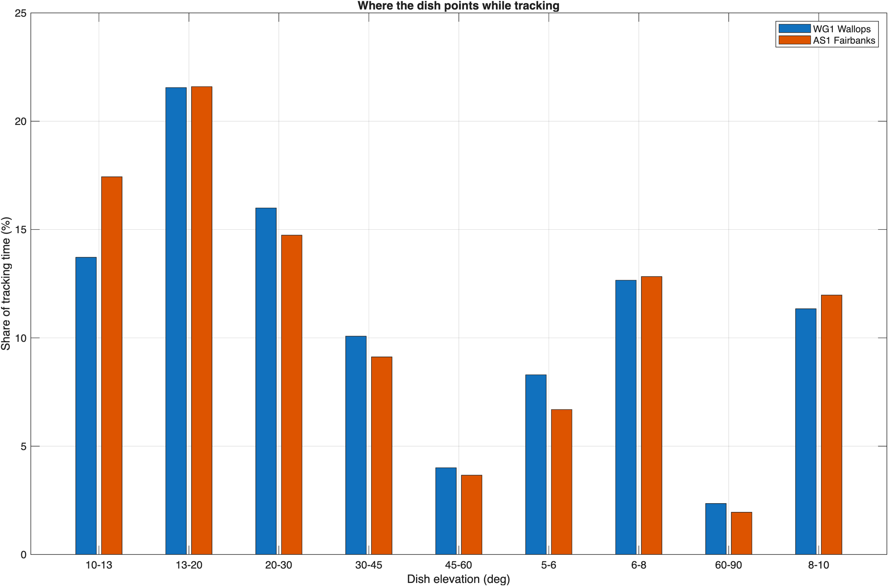
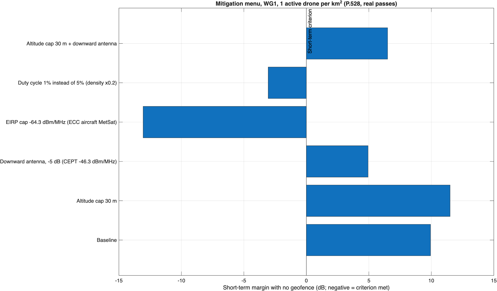

```
DRAFT - PRE-DECISIONAL AND DELIBERATIVE
Prepared with AI assistance. Reviewer: [CONFIRM]
Public and cleared sources only.
```

# Summary

This addendum replaces two of the most criticized simplifications in the Rev 0 working paper, free-space propagation and fixed dish pointing, and adds a ground UWB baseline, a quantified mitigation menu, and a risk metric. The run used `next_steps_analysis_rev1.m` on MATLAB R2025b; the full log is in `docs/next_steps_run_log_rev1.txt`.

- **The dish rarely points where low drones are.** Over 30 days of SGP4 passes of Aqua, Terra, Landsat 8, and Landsat 9, the WG1 (Wallops) dish tracks 11.1% of the time and AS1 (Fairbanks) 23.2%. Only 8.3% (WG1) and 6.7% (AS1) of tracking time is at 5° to 6° elevation, the band where a 400 ft drone can enter the main beam.
- **With P.528 and real pointing, smaller geofences suffice.** The long-term criterion is met by at least 13.8 dB at every density tested. The short-term criterion is met with no geofence at 0.01 and 0.1 active drones per km² at both sites. At 1 active drone per km², it needs a geofence of 0.4 km at WG1 and 0.2 km at AS1, compared with 1.3 km under the Rev 0 fixed-pointing assumption.
- **Ground UWB already permitted near a site contributes comparable long-term interference.** At ECC Report 327 urban densities, handheld and indoor UWB give long-term margins of -12.6 dB and -10.5 dB at WG1, against -13.8 dB for drones at 1 active per km². Drones matter mainly through the short-term tail, when one comes close to the dish's main beam.
- **Several single conditions close the gap at 1 active drone per km²:** a 1% duty cycle, or a 30 m altitude cap with a downward-directed antenna, or the European aircraft limit of -64.3 dBm/MHz.
- **The short-term tail is statistically noisy.** It rests on 5-10 Monte Carlo samples, and two runs of the same case differed by up to 3.8 dB. Results within a few dB of the criterion are undecided until the final runs use more iterations.

# What changed in the model

| Element | Rev 0 | This addendum |
| --- | --- | --- |
| Propagation | Free space, paths beyond the radio horizon dropped | ITU-R P.528-5 basic transmission loss from the validated MATLAB port ([itu_p528](https://github.com/nicklasorte/itu_p528)), time percentage drawn uniformly from 1% to 99% per device per iteration, as the 2.7 GHz working paper randomizes ITM reliability |
| Dish pointing | Fixed 13° (long term) and 5° (short term), random azimuth | Azimuth and elevation of a random tracking instant from 30 days of SGP4 passes, CelesTrak elements cached in `data/tle_eess.txt` |
| Percent of time | Share of all iterations | Share of tracking time (the dish isn't receiving when idle) |
| Victim antenna | 11.3 m, 57.48 dBi derived | 11.3 m with NEN Users' Guide G/T for AS1 and WG1 |
| Populations | Drones only | Drones, outdoor handheld UWB, indoor UWB (with ITU-R P.2108-1 clutter and 17 dB building entry loss) |
| Code | `aggregate_drone_mc_rev1` | `aggregate_drone_mc_rev3` (same model as rev2, about 1.6 times faster) |

# Results

## Single drone: P.528 against free space

One drone at 121.92 m in the dish azimuth, ITU-R SA.509-3 single-entry pattern, NEN 11.3 m antenna at 8160 MHz.

| Dish elevation | Long term, free space | Long term, P.528 at 50% | Long term, P.528 at 1% | Short term, free space | Short term, P.528 at 50% | Short term, P.528 at 1% |
| --- | --- | --- | --- | --- | --- | --- |
| 5° | 1.71 km | 1.71 km | 2.00 km | 1.35 km | 1.35 km | 1.41 km |
| 13° | 0.62 km | 0.62 km | 0.65 km | 0.52 km | 0.52 km | 0.52 km |

Inside the line-of-sight range, the P.528 median matches free space. The 1% values include ground reflection and atmospheric variability and set an upper bound.

## Dish pointing



| Site | Share of time tracking | Tracking minutes per day | Share of tracking time at 5°-6° | Share at 5°-10° |
| --- | --- | --- | --- | --- |
| WG1 Wallops | 11.1% | 160 | 8.3% | 32.3% |
| AS1 Fairbanks | 23.2% | 335 | 6.7% | 31.5% |

## Aggregate drones

Short-term margins and radii come from 100,000 iterations at 0.01 and 0.1 active drones per km², and 20,000 iterations at 1 per km² (resolution limited; see "Uncertainty").

| Site | Active drones per km² | Long-term margin | Short-term margin | Geofence needed | Share of tracking time above short-term criterion | Minutes per year above it |
| --- | --- | --- | --- | --- | --- | --- |
| WG1 Wallops | 0.01 | -36.8 dB | -15.6 dB | 0 km | 0.001% | 0.6 |
| WG1 Wallops | 0.1 | -25.3 dB | -8.4 dB | 0 km | 0.001% | 0.6 |
| WG1 Wallops | 1 | -13.8 dB | +7.5 dB | 0.4 km | 0.030% | 17.5 |
| AS1 Fairbanks | 0.01 | -36.8 dB | -14.8 dB | 0 km | 0% | 0 |
| AS1 Fairbanks | 0.1 | -25.3 dB | -0.3 dB | 0 km | 0.005% | 6.1 |
| AS1 Fairbanks | 1 | -13.8 dB | +2.3 dB | 0.2 km | 0.015% | 18.3 |

Negative margin means the criterion is met. The minutes column is the share above the criterion, times the share of time tracking, times one year.

## Ground UWB baseline at WG1

Urban active densities from ECC Report 327 as summarized by FiRa (2025): 7 outdoor and 500 indoor devices per km². WG1 is rural, so this is an upper bound for today's environment.

| Population | Active devices per km² | Long-term margin | Short-term margin |
| --- | --- | --- | --- |
| Outdoor handheld, 1.5 m | 7 | -12.6 dB | -14.2 dB |
| Indoor, 1.5 m, 17 dB building entry loss | 500 | -10.5 dB | -23.7 dB |

## Mitigation menu at WG1



| Mitigation | Short-term margin, 0.1 per km² | Short-term margin, 1 per km² | Geofence needed at 1 per km² | Minutes per year above, 1 per km² |
| --- | --- | --- | --- | --- |
| Baseline | -8.4 dB | +6.4 dB | 0.4 km | 11.7 |
| Altitude cap 30 m | -7.4 dB | +3.0 dB | 0.2 km | 7.0 |
| Downward antenna, -5 dB (CEPT -46.3 dBm/MHz above 2.5 m) | -13.4 dB | +1.4 dB | 0.2 km | 5.8 |
| EIRP cap -64.3 dBm/MHz (ECC Decision (12)03, aircraft, MetSat band) | -31.4 dB | -16.6 dB | 0 km | 0 |
| Duty cycle 1% instead of 5% | -13.5 dB | -0.7 dB | 0 km | 2.3 |
| Altitude cap 30 m and downward antenna | -12.4 dB | -2.0 dB | 0 km | 2.3 |

The two EIRP-reduction rows are exact dB shifts of the baseline run, not separate Monte Carlo runs. At 0.1 per km² the altitude cap shows a slightly worse margin than the baseline; that is Monte Carlo noise, not an effect (see "Uncertainty").

## Risk metric and the percent-of-time basis

ITU-R SA.1027-6 allows the short-term level to be exceeded 0.005% of the time, which is 26.3 minutes per year of total time. At 1 active drone per km², WG1 exceeds it for 0.03% of tracking time, which fails on a tracking-time basis, but only 11.7 to 17.5 minutes per year, which passes on a total-time basis. Which basis applies changes the conclusion, so it is item T1 in the joint assumptions agreement and should be settled before final runs.

# Uncertainty

- **Short-term tail.** With 100,000 iterations, the 0.005% point has about 5 samples beyond it; with 20,000, about 1. The same WG1 case at 0.1 per km² gave -4.6 dB in one run and -8.4 dB in another (different random streams). Treat short-term margins within about 4 dB of zero as undecided. The pre-registration protocol should require at least 1,000,000 iterations, or importance sampling, for final short-term results.
- **Minutes per year** are quantized at one iteration's share of time (0.6 to 6.1 minutes per year here, shown in the run log).
- **Pass statistics** use 30 days and four missions. Other missions supported at each site would raise tracking time.

# Not done

- **Calibration against ECC Report 327.** Its EESS earth station parameters (section 5.5) weren't retrievable from the public text, so the model hasn't been run against its 300-3,600 m single-entry and 100 m and 700 m aggregate results. This is the top open item.
- **P.2108-1 Eqn 3b** (location standard deviation) is implemented from a reconstructed form and needs checking against the official text. It affects only the ground UWB baseline.

# Performance note

The Monte Carlo was already vectorized. Profiling on R2025b showed the time going to random-number generation, the P.528 interpolation, and per-device trigonometry. The run took 463 s after three changes:

- Switching to the Threefry generator, whose `randn` is 10 times faster than `mrg32k3a`.
- Removing angle round trips.
- Deriving the EIRP-offset mitigation cases exactly from the baseline run.

`parfor` gives identical results but was slower on a two-worker laptop pool.
