```
DRAFT - PRE-DECISIONAL AND DELIBERATIVE
Prepared with AI assistance. Reviewer: [CONFIRM]
Rule text as of: 2026-11-07
Analysis run: 2026-11-10 (CCNY), 2026-11-11 (Wallops and CCNY bridge, duty cycle, and distance)
Public and cleared sources only.
```

# Overview

The Federal Communications Commission (FCC) Notice of Proposed Rulemaking (NPRM) on ultra-wideband (UWB) modernization, ET Docket No. 26-245, asks whether to relax the prohibition on UWB operation aboard aircraft in 47 CFR 15.521(a), and whether to permit UWB-based drone navigation and landing systems.[^nprm] NASA has raised concern that drones carrying IEEE 802.15.4 high-rate pulse (HRP) UWB radios on channel 9 could interfere with its Earth Exploration-Satellite Service (EESS) receive earth stations.

This paper does five things:

1. Identifies the space-to-Earth allocations and federal receive systems inside UWB channel 9 (7737.6-8236.8 MHz).
2. Collects public parameters for the UWB emission and for three candidate victim systems.
3. Calculates the distance at which one drone, in line of sight (LOS) and on the earth station boresight, reaches the applicable protection criteria, and then tests whether a drone can physically occupy that boresight.
4. Describes how the pulsed structure of the UWB emission appears inside each victim receiver and lists the data still needed.
5. Runs the full chain of calculations, step by step, at a real public X-band station in New York City, with drone density built from FAA data.

## What's new in Rev 1

- A site example at the CCNY NOAA-CREST X-band station in Manhattan, with each intermediate calculation shown (see "Site example: New York City").
- Drone density from FAA 2025 flight hours and Census population, replacing the assumed 0.1 and 1 per km² bracket.
- Confidence intervals on the short-term result, which Rev 0 left uncertain by about ±4 dB.
- Results on both time bases: all time and tracking time.
- The validated ITU-R P.2108 port for ground devices, with its effect separated into the formula fix and the short-path assumption.
- A consistency check against ECC Report 327 and measured channel 9 emissions from a shipping device.
- A table of the intermediate calculations NASA can check, and those that need NASA data.
- Rev 1.1: the assumption that drones can transmit, the duty cycles used in comparable studies in this band, the duty cycle at which drones would reach the allowance, and the distance inside which one drone exceeds each criterion, main beam and sidelobes, at the NASA NEN station at Wallops (see "Key assumptions: drones transmit, how often, and how close").

The analysis is implemented in MATLAB in the public repository `nicklasorte/7GHz_UWB_NRPM`. Appendix A maps each equation to the code.

## Bottom line

- **The bounding distance is tens of kilometers.** With one UWB drone at the 47 CFR 15.519 average limit, in free space and on the boresight of a large EESS dish, the interference reaches the ITU-R long-term criterion at about 42 km for a 11.3 m NASA Near Earth Network (NEN) antenna and about 37 km for the 10 m Landsat antenna at USGS EROS. For a 3 m Joint Polar Satellite System (JPSS) direct-broadcast terminal at 7812 MHz, the distance is about 6 km.
- **Geometry limits where that can happen.** A drone at the 400 ft (121.92 m) ceiling in 14 CFR 107.51(b) can sit on a 5° boresight only within about 1.3 km of the dish, and on a 13° boresight only within about 0.5 km. To be on a 5° boresight at 42 km, the drone would need to be about 3.8 km above the dish.
- **Inside that ring, the excess is large.** A drone on a 5° boresight at the 1.3 km geometric limit exceeds the long-term EESS criterion by about 30 dB at the NEN and Landsat antennas and the MetSat criterion by about 13 dB at a JPSS terminal.
- **With a realistic antenna pattern,** one hovering drone at 121.92 m in the dish azimuth exceeds the long-term criterion out to about 1.7 km (5° pointing). In the aggregate Monte Carlo analysis, a geofence of 0.3 km protects the short-term criterion at 0.1 active drones per km², and 1.3 km is needed at 1 active drone per km².
- **The pulsed emission matters for wideband receivers.** The 30 MHz JPSS receiver is narrower than every HRP mean pulse repetition frequency (PRF), so UWB looks noise-like there. The 375 MHz Landsat receiver resolves individual pulses. The FCC 1 ms averaging rule also lets in-packet power run up to 7.3 dB above the long-term average, which extends the short-term distance by a factor of about 2.3.

**Rev 1 site example, CCNY station in Manhattan (2.4 m dish):**

- **At realistic densities, drones meet the criteria.** Drone density built from FAA 2025 flight hours and Census population is about 0.03 airborne drones per km² in New York City on an average hour. With UWB transmitting 5% of the time, as ECC Report 327 assumes, drones meet the EESS and MetSat criteria with at least 16 dB to spare, even at peak hour with every drone carrying UWB.
- **The edge case is continuous transmission at peak hour.** If every drone carries UWB and transmits continuously at peak hour, the EESS short-term level sits at the criterion: +0.3 dB, with a 95% interval of -0.9 to +1.6 dB. A 250 m geofence covers that case, and about 1 km covers a bounding case at Manhattan density. The long-term criterion is met by at least 12.9 dB in every case.
- **Two assumptions decide the close cases.** On an all-time basis, the edge case is above the short-term criterion for 1.7 minutes a year, against 26 allowed. On a tracking-time basis it slightly exceeds. If UWB gets only 1% of the allowance (ECC Report 327's 20 dB apportionment), the 5% activity case exceeds the EESS short-term criterion by 3.9 dB and needs a 0.5 km geofence.
- **The method reproduces ECC Report 327.** With ECC's own earth station inputs, the model gives 595 m against ECC's 600 m. The differences from ECC are assumptions (apportionment and antenna height), not method.
- **Ground devices already legal today come closer to the long-term criterion than drones do:** within 9-15 dB at CCNY, against at least 12.9 dB for every drone case. A shipping channel 9 device, the AirTag, measures within 0.5 dB of the average limit, so modeling every drone at the limit isn't a large source of conservatism.

**Rev 1.1, assuming drones can transmit (NASA NEN station at Wallops, 11.3 m):**

- **Every study of UWB in this band assumes average activity of 5% or less.** ECC Report 327 uses 0.006%-5% by application, CEPT Report 9 assumes below 5%, Europe's low duty cycle rule caps transmission at 5% per second, and the NPRM proposes under 1% a day. One FiRa appendix table uses 6% for outdoor vehicles.
- **At Wallops, no duty cycle reaches the allowance.** Every drone near the station could transmit continuously and stay under the short-term allowance, by at least 5.8 dB even at a sustained peak density with ECC's 20 dB apportionment.
- **In Manhattan, the worst case needs a 7.3% duty cycle,** above every cited activity factor and more than seven times the NPRM's 1%, and only with the 20 dB apportionment. A sustained peak density six times the average would lower that to 1.2%.
- **Distance: inside about 1.3 km in the main beam, or tens of meters off it.** One drone at 400 ft exceeds the short-term criterion on the Wallops boresight out to 5.6 km, but can only meet the boresight of a 5° pass within 1.28 km. One degree off boresight it must be within 300 m; at 5°, within 40 m.
- **One drone at these duty cycles can't exceed the long-term criterion at any distance,** because that criterion allows 20% of the time. At 1% duty, using up the short-term allowance at Wallops would take about 2,100 passes with a drone moved to exactly the right spot in the main beam before each one.


These results are threshold distances against ITU-R sharing criteria. They aren't a finding of harmful interference as defined in 47 CFR 2.1, which depends on actual service degradation.

# Regulatory context

## The rulemaking

The NPRM was released October 1, 2026.[^lw] Paragraphs relevant to drones:

- **Paragraph 22** asks whether the 2002 prohibition on UWB aboard aircraft, ships, and satellites in § 15.521(a) remains warranted.
- **Paragraph 28** asks whether UWB-based autonomous drone navigation and landing systems should be permitted, and under what conditions, such as altitude limits, power limits, and duty-cycle limits.
- **Paragraph 29** asks about coexistence and safeguards such as geofencing and altitude-based restrictions.
- **Paragraph 30** asks supporters of expanded use to provide propagation modeling, link budgets, and coexistence studies. It states that the Commission doesn't intend drastic or wholesale changes to the air and space environments.
- **Paragraphs 37-38** propose a duty cycle under 1% in any 24-hour period for a new device category.
- **Paragraph 44** asks whether to allow installations up to 20 m to support low-altitude drone operations.
- **Footnote 63** gives the channel 9 center frequency, 7987.2 MHz.

The NPRM doesn't mention EESS or NASA. Comments are due 30 days after Federal Register publication, and replies 60 days after. [CONFIRM: Federal Register publication date and the resulting deadlines.]

## Current UWB rules

| Rule | Requirement |
| --- | --- |
| 47 CFR 15.519(c) | Average EIRP of -41.3 dBm/MHz in 3100-10600 MHz for handheld devices |
| 47 CFR 15.519(e) | Peak EIRP of 0 dBm in a 50 MHz bandwidth centered on the highest emission |
| 47 CFR 15.519 | No antennas mounted on outdoor structures; the device must be handheld |
| 47 CFR 15.521(a) | Operation aboard an aircraft, a ship, or a satellite is prohibited |
| 47 CFR 15.521(d) | Average limits are RMS measurements in a 1 MHz resolution bandwidth with 1 ms or less averaging time |
| 47 CFR 15.521(g) | With a resolution bandwidth (RBW) between 1 MHz and 50 MHz, the peak limit is 20 log (RBW/50) dBm |

## European precedent

ECC Decision (12)03 permits UWB aboard aircraft in 6.0-8.5 GHz at -41.3 dBm/MHz, but caps 7.75-7.9 GHz (meteorological satellite, MetSat) at -64.3 dBm/MHz when the aircraft is at or below 1000 m, and at -44.3 - 20 log10(10/x) dBm/MHz above 1000 m, where x is the height in kilometers.[^ecc1203] That is 23 dB below the U.S. handheld limit at low altitude. The supporting study, ECC Report 175, assumed two active devices per aircraft with 15 dB of fuselage attenuation downward, and it found that mitigation may be needed below 10,000 m to protect MetSat earth stations.[^ecc175] ECC Report 175 lists EESS at 8025-8400 MHz but doesn't analyze it. ECC Decision (06)04 excludes UWB in flying models and aviation. Drones carry no fuselage loss, so the European aircraft analysis understates the drone case.

## Drone altitude

14 CFR 107.51(b) limits small unmanned aircraft to 400 ft (121.92 m) above ground level, except within 400 ft of a structure.[^107] This paper uses 121.92 m as the drone ceiling. Operations above that height under waiver would extend main-beam coupling to longer distances (see "Simplified main-beam analysis").

# Spectrum overlap

## Allocations inside channel 9

IEEE 802.15.4 HRP channel 9 is centered at 7987.2 MHz with a 499.2 MHz bandwidth, so it spans 7737.6-8236.8 MHz.[^chan] The federal allocations below come from the NTIA space-spectrum inventory appendix (July 2021).[^ntiaapp]

| Band (MHz) | Overlap with ch 9 (MHz) | Primary allocations | Direction relevant here | Federal users named |
| --- | --- | --- | --- | --- |
| 7737.6-7750 | 12.4 | Fixed-satellite, mobile-satellite (space-to-Earth); fixed (secondary) | Space-to-Earth | DoD mission and TT&C [CONFIRM: 7550-7750 MHz row of the U.S. Table] |
| 7750-7900 | 150 | Meteorological-satellite (space-to-Earth); fixed | **Space-to-Earth** | NOAA: S-NPP, JPSS |
| 7900-8025 | 125 | Fixed-satellite, mobile-satellite (Earth-to-space); fixed (secondary) | Earth-to-space (satellite receives; out of scope) | DoD mission and TT&C |
| 8025-8175 | 150 | **EESS (space-to-Earth)**; fixed-satellite (Earth-to-space); fixed | **Space-to-Earth** | NASA: Aqua, Aura, Terra, NEN downlink antennas; NOAA: Jason-CS; DoD NGSO |
| 8175-8215 | 40 | **EESS (space-to-Earth)**; fixed-satellite and MetSat (Earth-to-space); fixed | **Space-to-Earth** | NASA: Aqua, Aura, Terra, NEN |
| 8215-8236.8 | 21.8 (of 185) | **EESS (space-to-Earth)**; fixed-satellite (Earth-to-space); fixed | **Space-to-Earth** | NASA: Aqua, Aura, Terra, NEN; NOAA: GOES-R series, S-NPP |

The 8025-8400 MHz rows carry U.S. footnote US258. [CITE: US258 text.]

```
MHz   7700      7800      7900      8000      8100      8200      8300      8400
       |---------|---------|---------|---------|---------|---------|---------|
UWB ch 9      [7737.6 ======================= 7987.2 ======================= 8236.8]
IEEE mask     0 dBr to +/-324.5 MHz, -10 dBr to +/-399.4 MHz, -18 dBr beyond
MetSat s-E      [7750 ===== 7900]                    JPSS HRD at 7812
E-s uplinks                    [7900 ==== 8025]
EESS s-E                                 [8025 ===================================== 8400]
                                         Aqua 8160, Terra/Landsat 8212.5
```


## What NASA is likely concerned about

Two space-to-Earth bands fall inside channel 9 at the full in-channel power:

- **EESS, 8025-8400 MHz.** 211.8 MHz of the 375 MHz band is inside the channel. This band carries NASA Earth science data downlinks (Aqua, Aura, Terra) to NEN antennas, direct-broadcast downlinks received by many university and agency terminals, and the Landsat 8 and 9 downlink, which USGS operates and which fills the full 375 MHz.[^landsat] The rest of the band, 8236.8-8400 MHz, sees the channel skirt at -10 dBr to -18 dBr (IEEE mask) or the full -41.3 dBm/MHz (FCC envelope).
- **MetSat, 7750-7900 MHz.** The entire band is inside the channel. JPSS satellites, which NASA builds for NOAA, transmit High Rate Data (HRD) at 7812 MHz to direct-broadcast terminals, and NASA's Direct Readout Laboratory supports those users.[^jpssicd]

This paper analyzes one representative receiver for each case, plus Landsat because its receiver bandwidth makes the pulse question sharpest.

# Candidate victim systems

| Parameter | JPSS HRD terminal | NASA NEN EESS antenna | Landsat 8/9 at USGS EROS |
| --- | --- | --- | --- |
| Service and band | MetSat (s-E), 7750-7900 MHz | EESS (s-E), 8025-8400 MHz | EESS (s-E), 8025-8400 MHz |
| Center frequency | 7812 MHz | 8160 MHz (Aqua) | 8212.5 MHz (fills the band) |
| Receiver bandwidth | 30 MHz assigned | [CONFIRM] | 375 MHz |
| Data rate and coding | 15 Mbps (25 Mbps from NOAA-21); QPSK; RS(255,223) + rate-1/2 convolutional | [CONFIRM] | 384 Mbps; rate-7/8 LDPC |
| Antenna diameter | 3 m (reference) | 11.3 m | 10 m |
| Main-beam gain G0 | 45.6 dBi (derived, eta = 0.6) | 57.5 dBi published for 11.3 m (SG1); 57.48 dBi derived | 56.5 dBi (derived, eta = 0.6) |
| G/T | 22.7 dB/K at 5° | 35.2 dB/K (AS1, Fairbanks), 34.5 dB/K (WG1, Wallops), at 10° | [CONFIRM] |
| System noise temperature | 194 K (derived from G/T and G0) | 170 K (AS1), 200 K (WG1), derived | [CONFIRM] |
| Polarization | RHCP | RHC/LHC selectable | [CONFIRM] |
| Minimum elevation | 5° | 5° | 5° |
| Required Eb/N0; minimum margin | 4.4 dB; 1 dB | [CONFIRM] | [CONFIRM] |
| Sites | 47 registered HRD users | Fairbanks AK, Wallops VA; commercial NEN at North Pole AK, South Point HI | Sioux Falls SD; Gilmore Creek AK |
| Source | JPSS-1 HRD-DBS RF ICD Rev A; NOAA OSPO | NEN Users' Guide, 453-NENUG Rev 5, Tables 2-1 and 3-3 | USGS |

The main-beam gain is G0 = 10 log10(eta (pi D/lambda)^2) from ITU-R SA.509-3, with an assumed aperture efficiency eta of 0.6. [CONFIRM: aperture efficiency for each antenna.] The 3 m JPSS antenna has D/lambda of about 78, below the D/lambda >= 100 range of the SA.509-3 sidelobe pattern, so the paper uses only its main-beam gain.

# UWB characteristics in channel 9

| Characteristic | Value | Source |
| --- | --- | --- |
| Center frequency, bandwidth | 7987.2 MHz, 499.2 MHz | IEEE 802.15.4 HRP; NPRM fn. 63 |
| Average EIRP | -41.3 dBm/MHz, RMS over 1 ms or less | 47 CFR 15.519(c), 15.521(d) |
| Average EIRP in 10 MHz (in-channel) | -31.3 dBm | Derived |
| Peak EIRP | 0 dBm in 50 MHz; 20 log (RBW/50) dBm for RBW 1-50 MHz | 47 CFR 15.519(e), 15.521(g) |
| Transmit PSD mask | 0 dBr within 0.65/Tp, -10 dBr to 0.8/Tp, -18 dBr beyond (1/Tp = 499.2 MHz) | IEEE 802.15.4 [CONFIRM: 2020 breakpoints] |
| Mean PRF | 62.4 MHz (BPRF); 124.8 or 249.6 MHz (HPRF) | IEEE 802.15.4z; MathWorks `lrwpanHRPConfig` |
| Peak PRF (chip rate in a burst) | 499.2 MHz (about 2 ns per chip) | IEEE 802.15.4 |
| Packet on-time | Not public for drone use; swept 0.1-1 ms | [CONFIRM] |
| Activity factor | 0.25% to 5% by application (ECC Report 327 Table 18); NPRM proposes under 1% per 24 hours for a new category | ECC Report 327 via FiRa (2025); NPRM paras. 37-38 |
| Antenna | Isotropic at the limit (no downward-directed pattern assumed) | Assumption; NPRM para. 29 |
| Polarization loss into a circular feed | 3 dB | cos^2(45°) |

# Pulsed nature of the UWB emission

A UWB HRP transmitter emits bursts of roughly 2 ns chips. How that energy appears in a federal receiver depends on three time scales: the pulse spacing (1/PRF), the receiver's impulse response (about 1/B for receiver bandwidth B), and the packet on-time.

## Noise-like and pulse-resolved regimes

NTIA Report 01-383 shows that when the pulse repetition rate exceeds the receiver bandwidth, overlapping pulse responses add to an approximately Gaussian, noise-like signal. When the receiver bandwidth is much larger than the repetition rate, the receiver resolves individual pulses, and Gaussian-based statistics no longer apply.[^01383] Dithering spreads the energy into a continuous spectrum; without it, the energy concentrates in spectral lines at multiples of the PRF. HRP UWB scrambles its pulses, so this paper treats the spectrum as continuous.

| Victim receiver | Bandwidth | BPRF 62.4 MHz | HPRF 124.8 MHz | HPRF 249.6 MHz |
| --- | --- | --- | --- | --- |
| JPSS HRD | 30 MHz | Noise-like | Noise-like | Noise-like |
| ITU-R reference bandwidth | 10 MHz | Noise-like | Noise-like | Noise-like |
| Landsat 8/9 | 375 MHz | Pulse-resolved, about 7.8 dB first-order peak-to-average | Pulse-resolved, about 4.8 dB | Pulse-resolved, about 1.8 dB |

The first-order peak-to-average ratio for a resolved pulse train is 10 log10(B/PRF). It omits pulse shape and the burst structure of BPRF, in which several chips at the 499.2 MHz peak PRF arrive together, so the burst, not the chip, may be the resolved event in a 375 MHz receiver. Measurement is needed to settle the actual value.

## The regulatory peak envelope

The rules allow a peak-to-average ratio well above the first-order value. With the peak limit scaled by 20 log (B/50) and the average by 10 log (B):

| Receiver bandwidth | Average EIRP | Peak envelope | Allowed peak-to-average |
| --- | --- | --- | --- |
| 1 MHz | -41.3 dBm | -34.0 dBm | 7.3 dB |
| 10 MHz | -31.3 dBm | -14.0 dBm | 17.3 dB |
| 30 MHz | -26.5 dBm | -4.4 dBm | 22.1 dB |
| 375 MHz | -15.6 dBm | 17.5 dBm | 33.1 dB (20 log extrapolated beyond 50 MHz) |

The 20 log scaling is defined in § 15.521(g) only for 1-50 MHz; the 375 MHz row is an extrapolation and an upper bound.

## In-packet power

The average limit is an RMS value over 1 ms or less. A packet shorter than 1 ms, alone in its 1 ms window, can therefore run at 10 log10(1 ms / t_on) above the limit while it transmits. The peak limit caps that boost: the in-packet average in 1 MHz can't exceed the 1 MHz peak limit of -34.0 dBm, so the boost is at most 7.3 dB.

| Packet on-time | Requested boost | Allowed boost |
| --- | --- | --- |
| 0.1 ms | 10.0 dB | 7.3 dB |
| 0.25 ms | 6.0 dB | 6.0 dB |
| 1 ms | 0 dB | 0 dB |

## What this means for the protection criteria

- **Long-term criterion (20% of time).** A drone that is active only a few percent of the time contributes its in-packet power for that fraction. With an activity factor below 20%, one drone can't cause a 20% exceedance by itself; the long-term criterion then becomes an aggregate question (many drones) or a hovering-drone question at high activity.
- **Short-term criterion (0.005% for EESS, 0.0125% for MetSat).** 0.005% of a year is about 26 minutes. A single drone transmitting at in-packet power for that long is plausible, so the short-term test should use in-packet power, not the 1 ms average.
- **Wideband receivers.** For a pulse-resolved receiver such as Landsat, the effect of interference on a rate-7/8 LDPC decoder depends on peak amplitude and pulse statistics, not average power alone. ITU-R SA.1027-6 states its criteria as average power and doesn't address impulsive interference. [CONFIRM: whether NASA or USGS have pulsed-interference tolerance data for these demodulators.]

# Protection criteria

| Band | Long term | Short term | Source |
| --- | --- | --- | --- |
| EESS 8025-8400 MHz | -150 dBW per 10 MHz, not exceeded more than 20% of time | -133 dBW per 10 MHz, not exceeded more than 0.005% | ITU-R SA.1027-6, terrestrial-path share |
| MetSat 7750-7900 MHz | -144 dBW per 10 MHz, 20% | -127 dBW per 10 MHz, 0.0125% | ITU-R SA.1026-5, aggregate from all sources |

The criteria apply at the antenna output. ITU-R SA.1027-6 Note 4 applies the terrestrial-path criteria to transmitting terrestrial stations, which includes a drone. ITU-R SA.1026-5 Table 2 uses 13° elevation for the long-term case and 5° for the short-term case at 8 GHz. With a 150 K system noise temperature, the EESS long-term criterion corresponds to I/N of about -13 dB.

The paper also reports distances at I/N = -6 dB and -10 dB in the actual receiver bandwidth where the noise temperature is known (JPSS).

# Simplified main-beam analysis

## Method

One drone is in LOS, on the earth station boresight, at the full average EIRP, with free-space loss and no clutter or shielding. The interference at the antenna output is

```
I = EIRP_B - FSPL(d, f) + G0 - L_pol                                  (1)
FSPL(d, f) = 20 log10(4 pi d / lambda)                                 (2)
```

where `EIRP_B` is the UWB EIRP in the victim bandwidth B. Setting I equal to the threshold `I_th` and solving for distance gives

```
d = (lambda / 4 pi) * 10^((EIRP_B + G0 - L_pol - I_th) / 20)            (3)
```

For the drone to be on a boresight at elevation `el` and distance d on a 4/3 Earth, its height above the dish must be

```
h = d tan(el) + d^2 / (2 k Re),  k = 4/3, Re = 6371 km                  (4)
```

The highest Part 107 drone is 111.92 m above a dish center at 10 m. Solving Equation 4 for that height gives the farthest distance at which boresight coupling is possible.

## Results

All distances use the in-channel EIRP of -31.3 dBm per 10 MHz and 3 dB polarization loss.

| Victim | G0 | Long-term distance | Short-term distance | Short-term, in-packet (+7.3 dB) | I/N = -6 dB | I/N = -10 dB |
| --- | --- | --- | --- | --- | --- | --- |
| JPSS HRD, 3 m, 7812 MHz | 45.6 dBi | 5.6 km | 0.8 km | 1.8 km | 4.3 km | 6.8 km |
| NASA NEN, 11.3 m, 8160 MHz | 57.5 dBi | 42.2 km | 6.0 km | 13.8 km | [CONFIRM: Tsys] | [CONFIRM: Tsys] |
| Landsat at EROS, 10 m, 8212.5 MHz | 56.5 dBi | 37.3 km | 5.3 km | 12.2 km | [CONFIRM: Tsys] | [CONFIRM: Tsys] |

| Dish pointing elevation | Farthest boresight distance for a 121.92 m drone | Height needed at the NEN long-term distance (42.2 km) |
| --- | --- | --- |
| 5° | 1.28 km | about 3.8 km |
| 13° | 0.48 km | about 9.8 km |

| Victim | Excess over the long-term criterion, drone on a 5° boresight at 1.28 km | On a 13° boresight at 0.48 km |
| --- | --- | --- |
| JPSS HRD | 12.8 dB | 21.0 dB |
| NASA NEN | 30.3 dB | 38.6 dB |
| Landsat at EROS | 29.3 dB | 37.5 dB |


## Interpretation

The free-space main-beam distance is a bound, not a prediction. It answers how far away a drone could be and still matter if it were on boresight. For drones that stay at or below 400 ft, boresight coupling happens only inside a ring of about 1.3 km during low-elevation passes, and inside that ring the excess is large. For drones above 400 ft, under waiver or a future rule, the bound becomes reachable: a drone at 1 km altitude is on a 5° boresight at about 11 km, inside every long-term distance in the table.

# Higher-fidelity analysis

The repository also implements two analyses that replace the main-beam assumption with the ITU-R SA.509-3 antenna pattern and real geometry. Both use the NEN 11.3 m antenna at 8100 MHz.

## Single drone, worst-case azimuth

One drone hovers in the dish azimuth at a set altitude while the dish points at a fixed elevation. The analysis sweeps ground distance and uses the SA.509-3 single-entry pattern.

| Drone altitude | Long-term separation, el 5° | el 13° | el 30° |
| --- | --- | --- | --- |
| 30 m | 0.58 km | 0.20 km | 0.08 km |
| 60 m | 0.96 km | 0.34 km | 0.14 km |
| 121.92 m | 1.71 km | 0.63 km | 0.25 km |


At 7800 MHz (MetSat, same antenna), the long-term separation at 121.92 m is 1.53 km at 5°.

## Aggregate Monte Carlo

Each Monte Carlo iteration draws a Poisson number of active drones, uniform in area out to the 58.5 km radio horizon and uniform in altitude from 10 m to 121.92 m, with a random dish azimuth. Interference is summed in milliwatts with the SA.509-3 multiple-entry pattern for every candidate geofence radius at once. The long-term runs use 13° pointing and 20,000 iterations; the short-term runs use 5° pointing and 200,000 iterations, which leaves about 10 samples beyond the 0.005% point. The active density is the drone density times the UWB activity factor.

| Active drones per km² | Required geofence radius | Long-term margin with no geofence | Short-term margin with no geofence | Highest EIRP with no geofence |
| --- | --- | --- | --- | --- |
| 0.001 | 0 km | -49.2 dB | -20.2 dB | -41.3 dBm/MHz |
| 0.01 | 0 km | -37.7 dB | -10.4 dB | -41.3 dBm/MHz |
| 0.1 | 0.3 km | -26.6 dB | +4.0 dB | -45.3 dBm/MHz |
| 1 | 1.3 km | -15.3 dB | +15.0 dB | -56.3 dBm/MHz |


Negative margin means the criterion is met. The short-term criterion governs at every density. The aggregate runs use the 1 ms average EIRP; using in-packet power for the short-term test adds up to 7.3 dB to the short-term margins.

# Site example: New York City

This section runs the full chain of calculations at one real, public X-band receive station in a dense city, one step at a time, so that NASA can check each intermediate number. The code is `matlab/example_station_ccny_rev1.m`. Every table below is also written as a CSV file to `output/ccny/`.

## Why this station

The NOAA Cooperative Remote Sensing Science and Technology Center (NOAA-CREST) Satellite Receiving Station at The City College of New York (CCNY), in upper Manhattan, operates a 2.4 m X-band tracking antenna in a weatherproof dome. It receives the polar-orbiting satellites Terra and Aqua (MODIS) and Suomi NPP (VIIRS).[^crest] It appears in the NASA Goddard Direct Readout Laboratory list of X-band stations (entry 154, 40.820° N, 73.950° W).[^drl] It is the X-band receiver in the largest U.S. city in that list.

It is an example of a class of receiver, not a NASA protection request. It is a university station, not a NASA facility, and it is smaller than NASA's NEN and Landsat antennas. A 2.4 m dish has about 13 dB less gain than an 11.3 m dish, so it is less exposed to a drone in its main beam. But it sits in the densest population, and so the densest drone traffic, of any station in the list. The paper's earlier NEN Wallops results remain the large-antenna case.

The analysis runs two victim links, both inside UWB channel 9:

- **EESS, 8160 MHz:** Aqua and Terra direct broadcast. Criteria from ITU-R SA.1027-6: -120 dBm in 10 MHz for 20% of the time (long term) and -103 dBm in 10 MHz for 0.005% of the time (short term).
- **MetSat, 7812 MHz:** Suomi NPP high rate data (HRD). Criteria from ITU-R SA.1026-5.

## Station inputs

| Item | Value | Source |
| --- | --- | --- |
| Location | 40.820° N, 73.950° W | NASA DRL X-band station list, entry 154 |
| Antenna diameter | 2.4 m | CUNY CREST station page |
| Satellites | Terra, Aqua, Suomi NPP | CUNY CREST station page |
| Aperture efficiency | 0.6 | Assumption; not published |
| Antenna height above ground | 20 m | Assumption (rooftop dome); not published |
| Minimum elevation | 5° | ITU-R SA.1026-5 |
| Antenna pattern | ITU-R F.699-5 (D/λ is about 63-65, below the SA.509-3 range of D/λ ≥ 100) | ITU-R F.699-5, SA.509-3 |
| Peak gain | 44.0 dBi at 8160 MHz | 10 log10(η (π D/λ)²) |
| 3 dB beamwidth | 1.07° at 8160 MHz | 70 λ/D |
| UWB polarization loss | 3 dB | Linear UWB antenna into a circular feed |
| Site shielding, dome loss | 0 dB | Assumption (conservative) |

## Step 1: Pass statistics

The model propagates public two-line elements with SGP4 for 30 days from November 1, 2026, at 20-second steps, and assumes the dish tracks the highest-priority satellite above 5°. When no satellite is in view, the dish isn't receiving.

| Link | Satellites | Share of time tracking | Tracking per day | Share of tracking below 6° | Median elevation |
| --- | --- | --- | --- | --- | --- |
| EESS 8160 MHz | Aqua, Terra | 5.9% | 85 min | 7.3% | 14.0° |
| MetSat 7812 MHz | Suomi NPP | 3.6% | 52 min | 7.1% | 14.6° |

The dish receives for about an hour and a half a day on the EESS link and under an hour on the MetSat link. This matters for how the time percentages in the criteria are counted (step 8).

## Step 2: Where a drone can be in the main beam

A drone is on the dish boresight only where its elevation, seen from the dish, equals the pointing elevation. On a flat Earth that ground distance is (h_drone - h_dish) / tan(elevation).

| Dish elevation | Drone at 10 m | Drone at 60 m | Drone at 121.92 m (400 ft) |
| --- | --- | --- | --- |
| 5° | Below the dish | 0.46 km | 1.17 km |
| 10° | Below the dish | 0.23 km | 0.58 km |
| 20° | Below the dish | 0.11 km | 0.28 km |
| 30° | Below the dish | 0.07 km | 0.18 km |
| 45° | Below the dish | 0.04 km | 0.10 km |

The main beam is about ±0.54° wide, so at 1.17 km it is about 22 m tall. A drone below the 20 m dish height can't enter the main beam at all.

## Step 3: Single-drone link budget

This is the worst single-drone case: a drone at 400 ft, hovering exactly on the boresight of a 5° pass, with the median (50% of time) ITU-R P.528-5 loss. A second budget shows a typical off-axis drone for contrast.

| Step | Boresight case | Off-axis case | Unit | Source |
| --- | --- | --- | --- | --- |
| UWB average EIRP limit | -41.3 | -41.3 | dBm/MHz | 47 CFR 15.519(c) |
| EIRP in the 10 MHz reference bandwidth | -31.3 | -31.3 | dBm | -41.3 + 10 log10(10) |
| Polarization loss | 3 | 3 | dB | Linear into circular |
| Drone height, ground distance | 121.92 m, 1.165 km | 121.92 m, 5 km | | Input |
| Slant range | 1.169 | 5.001 | km | 4/3-Earth geometry |
| Dish pointing (elevation, azimuth offset) | 5°, 0° | 20°, 30° | | Input |
| Off-axis angle | 0.004 | 34.9 | deg | Spherical law of cosines |
| Dish gain toward the drone | 44.0 | -4.7 | dBi | ITU-R F.699-5 |
| Free-space loss | 112.04 | 124.66 | dB | 20 log10(4πd/λ) |
| P.528-5 basic transmission loss | 112.05 | 124.72 | dB | ITU-R P.528-5, `itu_p528` |
| Interference at the antenna output | -102.3 | -163.7 | dBm/10 MHz | EIRP - losses + gain |
| Margin to the long-term criterion (-120) | +17.7 | -43.7 | dB | Positive = exceeds |
| Margin to the short-term criterion (-103) | +0.7 | -60.7 | dB | Positive = exceeds |

P.528 matches free space within 0.1 dB at these ranges, as it should for a short line-of-sight path. One drone on boresight is right at the short-term criterion. But the long-term criterion applies to 20% of the time, and one drone can't hold that position for 20% of every day's passes.

## Step 4: Single-drone interference map

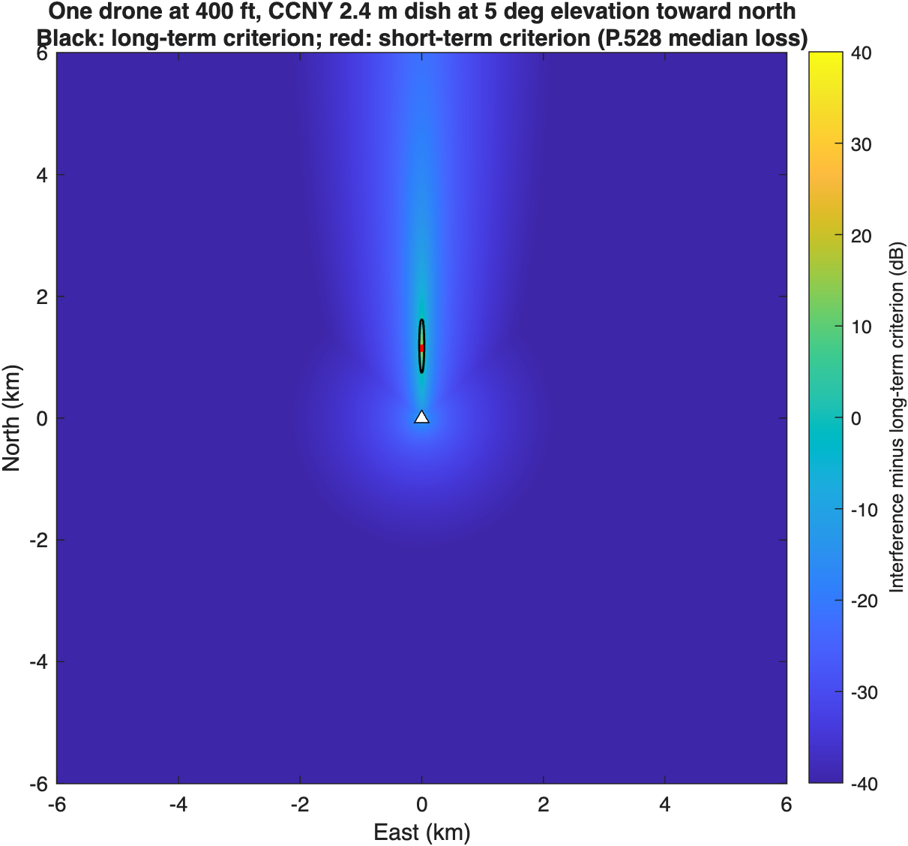

A drone at 400 ft exceeds the short-term criterion over 0.001 km² and the long-term criterion over 0.06 km², both in a narrow sliver along the dish azimuth. Elsewhere, interference is 20-60 dB below the criteria.

## Step 5: Drone density from FAA and Census data

The earlier analysis bracketed density at 0.1 and 1 active drone per km². This step replaces that bracket with a chain of public numbers. Each step is a separate column in `density_nyc.csv`.

| Step | Calculation | Value | Source |
| --- | --- | --- | --- |
| 1. Drones airborne in the U.S. on average | 21,676,799 flight hours in 2025 ÷ 8,760 h | 2,475 | FAA sUAS Survey Report 2025, Table 1[^faa] |
| 2. Per U.S. resident | ÷ 341,784,857 residents | 7.24 × 10⁻⁶ | Census Vintage 2025[^census] |
| 3. New York State adjustment | (1,366,899 NY flights ÷ 20,002,427 residents) ÷ (57,836,452 U.S. flights ÷ U.S. residents) | 0.40 | FAA survey Table 6; Census V2025 |
| 4. New York City density | 8,584,629 residents ÷ 778.2 km² = 11,032 per km² | 0.032 airborne per km² | NYC DCP, Census V2025[^nycdcp] |
| 4a. Manhattan only | 1,664,862 ÷ 58.7 km² = 28,367 per km² | 0.083 airborne per km² | NYC DCP |
| 5. Peak-hour factor | Swept 1, 3, 6 | | No public hourly distribution found |
| 6. Share carrying channel 9 UWB | Swept 0.1, 1 | | No public data |
| 7. UWB transmit activity | 5% (ECC Report 327 upper value) or 100% | | ECC Report 327 via FiRa[^fira] |

Step 4 assumes drones fly where people live. The FAA forecast says recreational ownership "maps closely against the population centers."[^faafcst] New York flies less per resident than the national average, which pulls the city density down. On an average hour, the result is about one airborne drone for every 31 km² of the city. The four cases the Monte Carlo runs are:

| Case | Active UWB drones per km² |
| --- | --- |
| Low: average hour, 10% carry UWB, 5% activity | 0.00016 |
| Mid: peak hour (×3), all carry UWB, 5% activity | 0.0048 |
| High: peak hour (×3), all carry UWB, transmitting continuously | 0.097 |
| Bound: Manhattan density, peak ×6, all carry UWB, continuous | 0.50 |

Even the bounding case sits below the 1 per km² upper bracket used in Rev 0.

## Step 6: Aggregate Monte Carlo with 95% confidence intervals

The Monte Carlo is the same model as the earlier P.528 analysis: Poisson drone counts out to 60 km, uniform heights from 10 m to 121.92 m, a random P.528 time percentage per drone, dish pointing drawn from the step 1 pass samples, and the multiple-entry antenna pattern. Drones get no clutter loss, because they fly above it. No geofence is applied.

Rev 0 left the short-term result uncertain by about ±4 dB, because only about 10 samples fell beyond the 0.005% point. This run sizes each case so that 50-500 samples fall beyond it, and reports exact 95% intervals:

- **For the level exceeded 0.005% of the time:** a distribution-free order-statistic interval. The number of samples below the true percentile is binomial, so the interval runs between two sorted samples.
- **For the share of time above the criterion:** a Clopper-Pearson (exact binomial) interval.

Positive margins mean the criterion is exceeded. The time shares are shares of tracking time. The last column applies the 20 dB apportionment that ECC Report 327 used for UWB (see step 11).

| Link | Case | Samples beyond the short-term point | Long-term margin | Short-term margin (95% interval) | Tracking time above short-term criterion (95% interval) | Geofence for the short-term criterion | With a 20 dB apportionment: short-term margin, geofence |
| --- | --- | --- | --- | --- | --- | --- | --- |
| EESS | Low | 200 | -55.9 dB | -33.9 (-34.2 to -33.1) dB | 0% (0% to 9.2e-05%) | None | -13.9 dB, None |
| EESS | Mid | 200 | -36.3 dB | -16.1 (-16.9 to -15.4) dB | 0.00028% (0.00014% to 0.00049%) | None | +3.9 dB, 0.5 km |
| EESS | High | 50 | -21.1 dB | +0.3 (-0.9 to +1.6) dB | 0.0055% (0.0041% to 0.0072%) | 0.25 km | +20.3 dB, 1.5 km |
| EESS | Bound | 30 | -12.9 dB | +7.6 (+6.2 to +8.4) dB | 0.0248% (0.021% to 0.0292%) | 1 km | +27.6 dB, 2 km |
| MetSat | Low | 500 | -61.4 dB | -43.1 (-43.5 to -42.7) dB | 0% (0% to 9.2e-05%) | None | -23.1 dB, None |
| MetSat | Mid | 500 | -41.8 dB | -26.1 (-26.5 to -25.6) dB | 0.00013% (4.1e-05% to 0.00029%) | None | -6.1 dB, None |
| MetSat | High | 125 | -26.7 dB | -11.1 (-11.9 to -10.1) dB | 0.0012% (0.00062% to 0.0021%) | None | +8.9 dB, 1 km |
| MetSat | Bound | 75 | -18.5 dB | -2.3 (-3.1 to -0.9) dB | 0.0083% (0.0062% to 0.011%) | None | +17.7 dB, 1.5 km |

The short-term intervals in the drone cases are now 0.8-2.6 dB wide, against about ±4 dB in Rev 0. At the EESS link:

- With the ECC activity factor of 5% (Low and Mid cases), the criteria are met with at least 16 dB to spare.
- With every drone carrying UWB and transmitting continuously at peak hour (High case), the short-term level is at the criterion: the interval includes zero.
- The bounding Manhattan case exceeds it, and a geofence of about 1 km protects it.

The MetSat link meets its criteria in every case, with 1-3 dB to spare in the bound. The long-term criterion is met by at least 12.9 dB in every case on both links.

The apportionment column changes the picture. If UWB gets only 1% of the interference allowance, as ECC assumed for ground UWB, the Mid case (5% activity, which ECC treats as realistic) exceeds the EESS short-term criterion. The High and Bound cases then need geofences of about 1.5 km and 2 km at the EESS link. Whether an apportionment applies, and how large, is the single assumption that moves these results most.

## Step 7: Independent check of the short-term result

The short-term criterion is usually broken by one drone near the main beam, not by many weak ones. If that's true, a simple calculation should reproduce the Monte Carlo:

1. Place single drones at random, with the same height, P.528 time, and pointing distributions, and count how often one drone alone exceeds the short-term criterion. Multiplying by the sampled area gives the equivalent exceedance footprint, the area that must be free of drones while the dish tracks.
2. Predict the share of time with at least one drone in that footprint from Poisson statistics: 1 - exp(-density × footprint).

| Link | Footprint (95% interval) | Farthest single-drone exceedance |
| --- | --- | --- |
| EESS 8160 MHz | 629 m² (505 to 774 m²) | 1.03 km |
| MetSat 7812 MHz | 191 m² (126 to 278 m²) | 0.59 km |

The Poisson prediction falls inside the Monte Carlo 95% interval in the Mid and High cases on both links and in the MetSat bound. In the EESS bound it is about 25% high: it predicts 0.031% of tracking time against a Monte Carlo 0.025% (95% interval 0.021% to 0.029%). That is expected. The check uses the footprint averaged over all dish pointings, but at any moment every drone sees the same pointing, and low passes have much larger footprints than high ones. Averaging first makes the Poisson formula an upper bound, which tightens as density falls. The check therefore confirms the Monte Carlo from above and agrees with it where the density is realistic (see the `poisson_pred_pct` column in `aggregate_drones.csv`). The EESS footprint is about 630 m², a patch about 25 m on a side. That is the physical picture for NASA: the short-term risk comes from a drone passing through a sliver of sky about a kilometer long, in the direction the dish is pointing, at the moment it's pointing there.

## Step 8: Time basis

The criteria are percentages of time, and it matters whether "time" means all time or only the time the dish is receiving. Figure 7 shows both. The all-time curves (solid) are the tracking-time curves (dotted) scaled down by the share of time the dish tracks, about 6% (EESS) and 4% (MetSat).

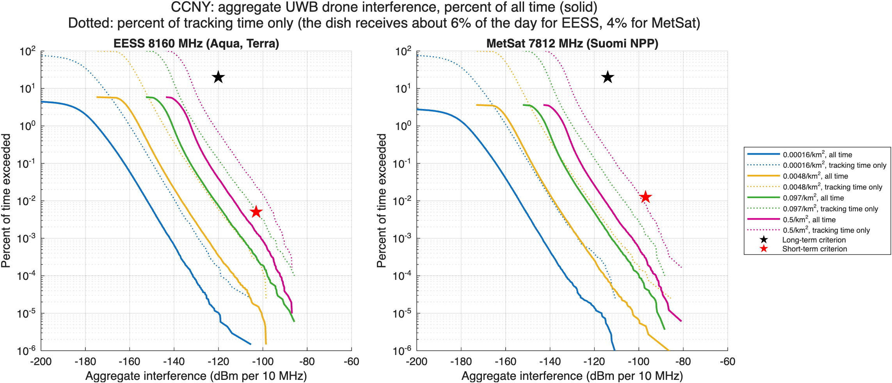

In minutes per year, the High case puts the EESS link above the short-term criterion for about 1.7 minutes. The 0.005% criterion allows 26 minutes per year if counted over all time, or about 1.5 minutes per year if counted over tracking time only. The choice of basis, not the propagation or density model, is what decides the High case. This paper makes no choice between the bases. It's a question for the joint assumptions agreement.

## Step 9: Ground UWB baseline at the same station

For context, the same model runs the ground devices that are already legal today: phones and tags in outdoor hands at 7 per km², and indoor devices at 500 per km² with 17 dB of building loss. These are the ECC Report 327 urban densities, as summarized by FiRa. Ground devices get ITU-R P.2108-1 terrestrial clutter loss from the validated port (`nicklasorte/itu_p2108`).

P.2108 doesn't cover paths shorter than 0.25 km. This paper assumes no clutter loss on those paths, the conservative choice, and reports the alternative (holding the 0.25 km loss) as a sensitivity.

| Link | Population | Long-term margin (95% interval) | Long-term margin, holding the 0.25 km loss |
| --- | --- | --- | --- |
| EESS | Handheld outdoor, 7 per km² | -10.0 dB (-10.1 to -9.8) | -26.9 dB |
| EESS | Indoor, 500 per km² | -8.6 dB (-8.7 to -8.6) | -24.3 dB |
| MetSat | Handheld outdoor, 7 per km² | -15.4 dB (-15.6 to -15.3) | -32.3 dB |
| MetSat | Indoor, 500 per km² | -14.1 dB (-14.1 to -14.0) | -29.6 dB |

Under the conservative short-path rule, the ground devices already legal today come within about 9-15 dB of the long-term criterion at CCNY. That's closer than any drone case in step 6, where the long-term margin is at least 12.9 dB even in the bounding case. Holding the 0.25 km loss moves the ground baseline about 16-17 dB further below the criterion. Drones differ from ground devices in two ways. They have no clutter, and they can rise into the main beam. That's why the short-term criterion, not the long-term one, is the issue for drones.

## Step 10: What the validated clutter model changed

Rev 0 used a reconstruction of P.2108 section 3.2 that capped the distance at 2 km. The validated port follows the NTIA reference: min(L(2 km), L(d)). The two differ by up to 1.02 dB below 2 km and 0.034 dB beyond, at high location percentages (Figure 8).

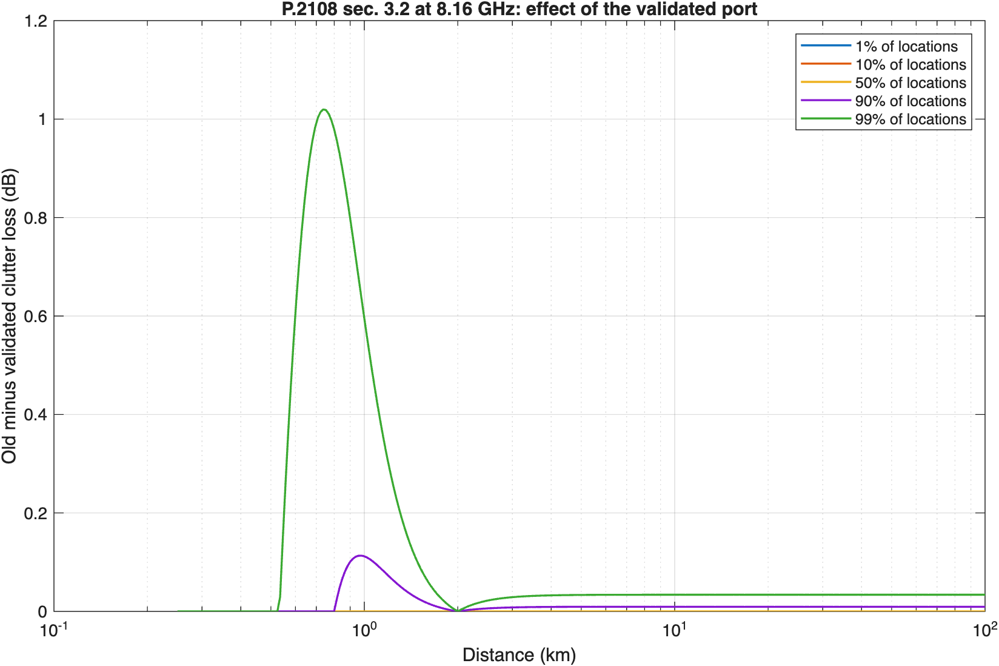

The step separates the formula fix from the short-path assumption, at the NEN Wallops station:

| Population | Rev 0 code | Validated port, no clutter below 0.25 km | Validated port, 0.25 km loss below 0.25 km |
| --- | --- | --- | --- |
| Handheld outdoor | -12.6 dB | -12.6 dB (-12.8 to -12.5) | -30.0 dB |
| Indoor | -10.5 dB | -10.5 dB (-10.6 to -10.5) | -26.6 dB |

The formula fix alone changes the long-term ground baseline by less than 0.1 dB: the 20% level is set by devices within a few hundred meters, where the two formulas agree or don't apply. The short-path assumption moves it by about 16-17 dB, because the nearest devices set that level. The next-steps addendum compared drones with the ground baseline using the first column, which matches the conservative rule, so that comparison stands.

The section 3.3 aeronautical clutter model of P.2108 isn't used anywhere in this analysis. It is valid only from 10 GHz to 100 GHz, and it models a ground terminal in clutter looking up, not a drone transmitting down to a station.

## Step 11: Consistency with ECC Report 327 and a measured device

ECC Report 327 (2021) studied ground UWB against EESS and MetSat earth stations in 6-8.5 GHz with the same SA.1027-6 and SA.1026-5 criteria used here.[^ecc327] Its single-entry studies found separation distances "between 300 m and 3600 m," and its aggregate studies found 100 m for fixed outdoor devices. Section 5.5 gives the parameters behind its earth station cases, which makes a direct calibration possible.

**Calibration.** The model reruns ECC's two single-entry cases with ECC's inputs: for EESS, an 8 m dish at 8 m height (Table 62); for MetSat, a 3 m dish at 4 m (Table 65). Both cases use a dish pointing at 5°, a device at 10 m, -41.3 dBm/MHz with no polarization loss, line-of-sight loss, and the short-term criterion reduced by a 20 dB apportionment for UWB.

| ECC case | This model | ECC Report 327 |
| --- | --- | --- |
| EESS 8 m dish at 8 m, 8200 MHz, device at 10 m, dish 5 deg, free space, criterion -123 dBm/10 MHz (20 dB apportionment), this model's off-axis gain | 625 m | 600 m (ECC Report 327 Table 62) |
| EESS 8 m dish at 8 m, 8200 MHz, as above with ECC's fixed horizon gain of 14.5 dBi | 595 m | 600 m (ECC Report 327 Table 62) |
| MetSat 3 m dish at 4 m, 7800 MHz, device at 10 m, dish 5 deg, free space, criterion -117 dBm/10 MHz (20 dB apportionment), this model's off-axis gain | 440 m | 300 m (ECC Report 327 Table 65) |
| MetSat 3 m dish at 4 m, 7800 MHz, as above with ECC's fixed horizon gain of 15.4 dBi | 350 m | 300 m (ECC Report 327 Table 65) |

With ECC's fixed horizon gain, the EESS case reproduces ECC's 0.6 km. The MetSat case gives 350 m against ECC's 300 m. ECC's stated loss at 300 m is 101 dB from P.452-16, about 1.2 dB more than free space. With that loss, the link budget gives ECC's -117 dBm exactly: -31.3 dBm + 15.4 dBi - 101 dB. When this model computes the actual off-axis angle instead of a fixed horizon gain, both distances grow, because a 10 m device sits slightly above a lower dish.

**What the calibration shows NASA.** The link budget reproduces ECC's numbers. The difference between ECC and this paper is in two assumptions, not in the method:

- **Apportionment.** ECC cut the criteria by 20 dB for UWB. This paper's drone results use the full criteria, and step 6 shows the 20 dB case beside them.
- **Antenna height.** ECC put the device 2-6 m above the dish. At CCNY the dish is assumed 18.5 m above a handheld device, which keeps the device far off-axis.

**Consistency with this paper's own assumptions.** The table reruns ECC's scenario types with this paper's stations and full criteria:

| Station | Scenario | This model | ECC Report 327 |
| --- | --- | --- | --- |
| CCNY 2.4 m | Single entry, 100% duty, LOS, dish 20 m high at 13 deg, long-term | 15 m | 300-3600 m |
| CCNY 2.4 m | Single entry, 100% duty, LOS, dish 20 m high at 13 deg, short-term | 0 m | 300-3600 m |
| CCNY 2.4 m | Single entry, 100% duty, LOS, dish 20 m high at 5 deg, long-term | 15 m | 300-3600 m |
| CCNY 2.4 m | Single entry, 100% duty, LOS, dish 20 m high at 5 deg, short-term | 0 m | 300-3600 m |
| CCNY 2.4 m | Single entry, 100% duty, LOS, dish 1.5 m high at 13 deg, long-term | 115 m | 300-3600 m |
| CCNY 2.4 m | Single entry, 100% duty, LOS, dish 1.5 m high at 13 deg, short-term | 20 m | 300-3600 m |
| CCNY 2.4 m | Single entry, 100% duty, LOS, dish 1.5 m high at 5 deg, long-term | 375 m | 300-3600 m |
| CCNY 2.4 m | Single entry, 100% duty, LOS, dish 1.5 m high at 5 deg, short-term | 55 m | 300-3600 m |
| CCNY 2.4 m | Aggregate fixed outdoor, urban (20 active/km^2), long-term, flat, no clutter | 550 m | 100 m |
| CCNY 2.4 m | Aggregate fixed outdoor, suburban (2.5 active/km^2), long-term, flat, no clutter | 0 m | 100 m |
| CCNY 2.4 m | Aggregate fixed outdoor, rural (0.5 active/km^2), long-term, flat, no clutter | 0 m | 100 m |
| WG1 11.3 m | Single entry, 100% duty, LOS, dish 10 m high at 13 deg, long-term | 40 m | 300-3600 m |
| WG1 11.3 m | Single entry, 100% duty, LOS, dish 10 m high at 13 deg, short-term | 0 m | 300-3600 m |
| WG1 11.3 m | Single entry, 100% duty, LOS, dish 10 m high at 5 deg, long-term | 175 m | 300-3600 m |
| WG1 11.3 m | Single entry, 100% duty, LOS, dish 10 m high at 5 deg, short-term | 0 m | 300-3600 m |
| WG1 11.3 m | Single entry, 100% duty, LOS, dish 1.5 m high at 13 deg, long-term | 95 m | 300-3600 m |
| WG1 11.3 m | Single entry, 100% duty, LOS, dish 1.5 m high at 13 deg, short-term | 15 m | 300-3600 m |
| WG1 11.3 m | Single entry, 100% duty, LOS, dish 1.5 m high at 5 deg, long-term | 300 m | 300-3600 m |
| WG1 11.3 m | Single entry, 100% duty, LOS, dish 1.5 m high at 5 deg, short-term | 45 m | 300-3600 m |
| WG1 11.3 m | Aggregate fixed outdoor, urban (20 active/km^2), long-term, flat, no clutter | 0 m | 100 m |
| WG1 11.3 m | Aggregate fixed outdoor, suburban (2.5 active/km^2), long-term, flat, no clutter | 0 m | 100 m |
| WG1 11.3 m | Aggregate fixed outdoor, rural (0.5 active/km^2), long-term, flat, no clutter | 0 m | 100 m |

With the dish well above a 1.5 m device and no apportionment, single-entry distances are tens of meters or less. With the dish at the device height, they rise to 300-375 m for the long-term criterion at 5° pointing, the low end of ECC's range. The aggregate urban case gives 550 m at CCNY against ECC's 100 m. ECC's aggregate parameters (Table 66) were only partly retrieved, so that difference isn't explained yet. Antenna height is the station input NASA should confirm first.

Measured emissions support the emission model. The FCC test report for the Apple AirTag (FCC ID BCGA2187, UL report 12791034-E2V3) gives these channel 9 results:[^airtag]

| Quantity | Measured | Limit used in this paper | Headroom |
| --- | --- | --- | --- |
| Average EIRP, worst configuration | -41.84 dBm/MHz | -41.3 dBm/MHz | 0.54 dB |
| Average EIRP, lowest configuration | -43.45 dBm/MHz | -41.3 dBm/MHz | 2.15 dB |
| Peak EIRP, worst configuration | -0.6 dBm/50 MHz | 0 dBm/50 MHz | 0.6 dB |
| -10 dB bandwidth | 525.5-528 MHz | 500 MHz minimum | |

A shipping channel 9 device runs within about 0.5 dB of the average limit. Modeling every drone at the limit overstates a real device by only that much, so the paper's EIRP assumption is not a large source of conservatism.

## Intermediate calculations for NASA review

The steps above are the intermediate calculations behind every result in this section. The table lists them with their status, plus the further calculations NASA would need to check the result at one of its own stations.

| Calculation | Status | What NASA can check or supply |
| --- | --- | --- |
| UWB EIRP in the 10 MHz reference bandwidth | Done (step 3) | Whether any airborne device would transmit below the limit; the AirTag runs 0.5-2 dB below it |
| Protection criteria in dBm per 10 MHz | Done (SA.1027-6, SA.1026-5) | Whether NASA applies different criteria, such as an I/N for a specific receiver |
| Criteria expressed as I/N at the station | Not done | System noise temperature and receiver bandwidth for each station |
| Pass statistics: tracking share and elevation histogram | Done (step 1) | Actual schedules and minimum elevations, which can differ from SGP4 visibility |
| Main-beam geometry | Done (step 2) | Antenna height above ground, terrain mask, and dome loss |
| Antenna gain toward the drone | Done (steps 3-4) | Measured pattern, or confirmation of SA.509-3 or F.699-5 |
| Air-to-ground loss | Done (P.528-5) | Local terrain and building blockage, which this paper ignores |
| Drone density chain | Done (step 5) | Local drone traffic data near each station |
| Aggregate interference with confidence intervals | Done (step 6) | Agreement on case selection and sample sizes |
| Independent footprint check | Done (step 7) | Review of the footprint method |
| Time basis | Shown both ways (step 8) | Which basis NASA's criteria assume |
| Ground UWB baseline | Done (step 9) | Whether NASA has observed interference from existing UWB |
| Clutter-model effects | Done (step 10) | Agreement on the short-path clutter assumption |
| Calibration against ECC Report 327 | Done (step 11): reproduces ECC's 0.6 km EESS case | Whether NASA accepts ECC's 20 dB apportionment for UWB |
| Apportionment sensitivity | Done (step 6) | The share of the criteria NASA would allow UWB |
| Effect of UWB pulses on the demodulator | Not done | Laboratory measurement through the actual receiver (see the ITS test plan) |
| Minutes per year above each criterion, per station | Done for CCNY (step 8) | Station-by-station runs with NASA inputs |

# Key assumptions: drones transmit, how often, and how close

The research question is at what point a drone, operating under normal conditions with a typical UWB device, causes interference to a NASA receiver. Two inputs decide the answer: how often the drone transmits (duty cycle) and how close it is (distance). They act separately. Distance comes from power: it's the distance inside which one drone's interference exceeds the criterion level whenever it transmits. Duty cycle comes from time: it sets how long a drone must stay inside that distance to use up the time allowance. This section states both assumptions, cites the duty cycles used in comparable studies in this band, and gives the results for the NASA NEN station at Wallops (WG1, 11.3 m) and, for comparison, the CCNY station in Manhattan (2.4 m).

The code is `matlab/example_bridge_rev1.m` (steps 9 and 10) and `matlab/threshold_distance_rev1.m`. The results are in `docs/bridge_results/` from the November 11, 2026 run.

## Assumption 1: drones are allowed to transmit

Today, 47 CFR 15.521(a) prohibits UWB operation aboard an aircraft, and the drone UWB products found are built so the drone only receives (see `docs/research_drone_uwb_operations_rev0.md`). This paper assumes the prohibition is lifted for drones. The NPRM asks "whether UWB-based autonomous drone navigation and landing systems should be permitted," and lists "altitude limits, power restrictions, and duty cycle limits" as possible conditions.[^nprm] The analysis takes that question as answered yes, with no duty-cycle limit specific to drones.

## Assumption 2: duty cycle, from the studies in this band

Every compatibility study of UWB in the 6-8.5 GHz band found for this paper models average activity at or below 5%, with one exception: one appendix table of the FiRa report uses 6% for outdoor vehicles.[^fira] The only higher value is 100%, used in single-entry worst cases.

| Source | Context | Duty cycle or activity factor |
| --- | --- | --- |
| ECC Report 327 (2021), Tables 1, 6, and 18[^ecc327] | UWB applications in 6-8.5 GHz, based on IEEE 802.15.4z | Physical access control 0.006%; parking management 0.05% (0.25% in Table 18); outdoor logistics 0.3%; in-vehicle 0.4%-1%; indoor positioning 1%; vehicle-mounted fixed outdoor 0.5% (rural), 2% (suburban), and 5% (urban) |
| ECC Report 327, Tables 67-80[^ecc327] | Aggregate studies into EESS, MetSat, and space research earth stations | The same application values, plus 5% for generic indoor and outdoor devices carried over from ECC Report 64 |
| ECC Report 327, section 0.5.1[^ecc327] | Single-entry studies into EESS and MetSat earth stations | 100% (worst case) |
| CEPT Report 9 (2005)[^cept9] | First European study of 6-8.5 GHz | Average activity factor assumed below 5% |
| ECC Report 94 (2006)[^ecc94] | Low duty cycle mitigation, 3.4-4.8 GHz | Sum of on-times below 5% per second and 0.5% per hour; each burst at most 5 ms |
| FiRa Consortium simulation report (2025)[^fira] | U.S. channel 9 aggregate interference, from ECC Report 327 Table 18 | 0.01% to 5% in the main study, treated as the probability of transmission; 6% for outdoor vehicles in one appendix table |
| FCC 26-66, NPRM (2026)[^nprm] | Proposed new low-power UWB device category | "Under one percent in any 24-hour period" |
| 47 CFR 15.519(a)(1)[^cfr519] | U.S. hand-held UWB rule today | No percentage limit; a device transmits "only when it is sending information to an associated receiver" and stops within 10 seconds without an acknowledgment |

ECC Report 327 explains the low values: the market moved from the high-data-rate UWB assumed in 2005 to low-data-rate ranging and location under IEEE 802.15.4z, which "leads to a significant reduction of the assumed activity factors."[^ecc327]

**The paper's duty-cycle assumption:** the base case uses 1%, from the NPRM's proposed limit. Results are shown across the cited range (0.05%, 0.3%, 1%, and 5%) and at continuous transmission (100%) as a bound no study in this band uses for average activity.


## Result: the duty cycle at which drones would reach the allowance

The share of time above the short-term criterion grows in proportion to the duty cycle, so each case has a break-even duty cycle at which it reaches the allowance. These results assume every drone carries UWB (a bound, since there is no public data on the share), the AirTag's measured EIRP, and local drone density from FAA and Census data (`docs/bridge_results/duty_break_even_*.csv`).

| Station | Density | Basis | At continuous transmission | Break-even duty cycle |
| --- | --- | --- | --- | --- |
| Wallops (NASA) | Annual average | Tracking time, full criterion | -30.3 dB | None: stays under at 100% |
| Wallops (NASA) | Annual average | All time, full criterion | -39.8 dB | None |
| Wallops (NASA) | Annual average | Tracking time, 20 dB apportionment | -13.6 dB | None |
| Wallops (NASA) | Sustained peak, 6 times average | Tracking time, 20 dB apportionment | -5.8 dB | None |
| CCNY | Annual average | Tracking time, full criterion | -5.2 dB | None |
| CCNY | Annual average | Tracking time, 20 dB apportionment | +11.3 dB | **7.3%** |
| CCNY | Sustained peak, 6 times average | Tracking time, full criterion | +2.6 dB | 55% |
| CCNY | Sustained peak, 6 times average | Tracking time, 20 dB apportionment | +19.1 dB | 1.2% |

The values are dB relative to the allowance: negative is under.

**At the NASA station, no duty cycle reaches the allowance.** Every drone near Wallops could transmit continuously and stay under it, by at least 5.8 dB even at a sustained peak density with ECC's 20 dB apportionment.

**At CCNY, the only case that reaches the allowance at annual-average density needs a 7.3% duty cycle.** That's above every average activity factor in the studies cited above (5% in ECC's work, 6% in one FiRa appendix table), above the European low duty cycle limit of 5% per second, and more than seven times the NPRM's proposed 1%. It also needs the 20 dB apportionment, a policy choice this paper doesn't make.

**The caveat is sustained peak density.** If drone traffic in Manhattan held six times its annual average around the clock, the apportioned case would break even at 1.2%: still above the NPRM's 1%, but inside ECC's range. A sustained peak is a bound: the criteria are percentages of a year, and the annual average is the density that matches them.

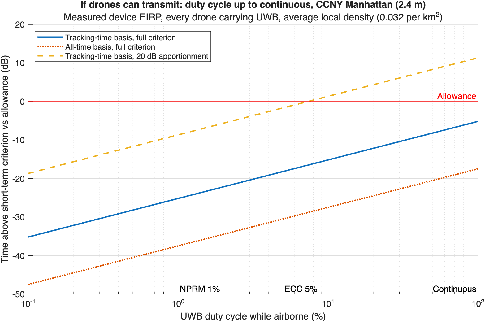

## Result: how close one drone has to be

For one drone at 400 ft, at the AirTag's measured EIRP, with 3 dB polarization loss and P.528 median loss, the table gives the slant distance inside which the drone exceeds each criterion whenever it transmits, by its angle off the dish boresight (`docs/bridge_results/threshold_distance_*.csv`). Distance doesn't depend on duty cycle.

Figures 11 and 12 show what the main-beam distance means on the ground at Wallops. Seen from above, one drone at 400 ft exceeds the short-term criterion during a 5° pass only inside a region 119 m long and 10 m wide, 1,221 m to 1,339 m out along the pointing azimuth. Seen from the side, that region is where the beam passes through the drone band below the 400 ft ceiling: the beam centerline crosses 400 ft at 1.28 km, and the exceedance region leaves the band at 1.33 km. For a 10° pass, it leaves at 0.66 km.

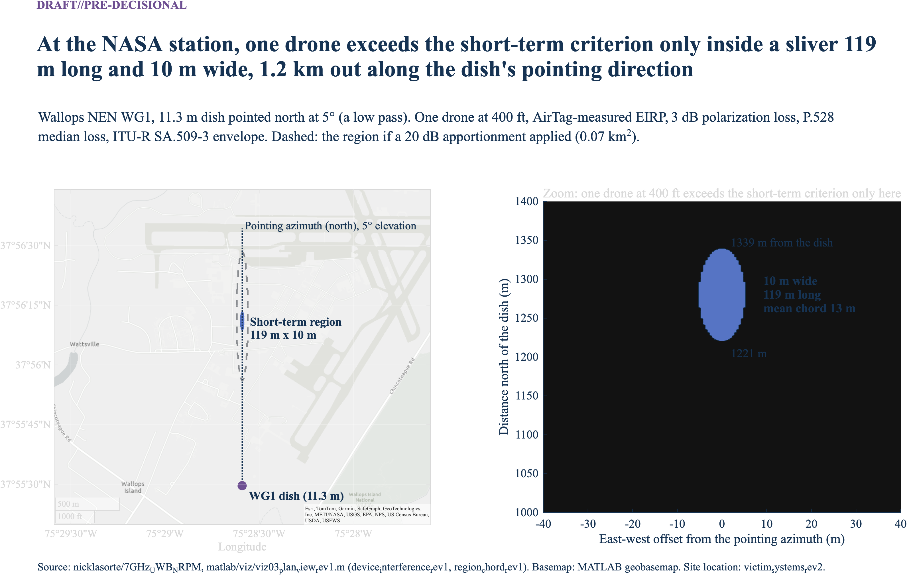

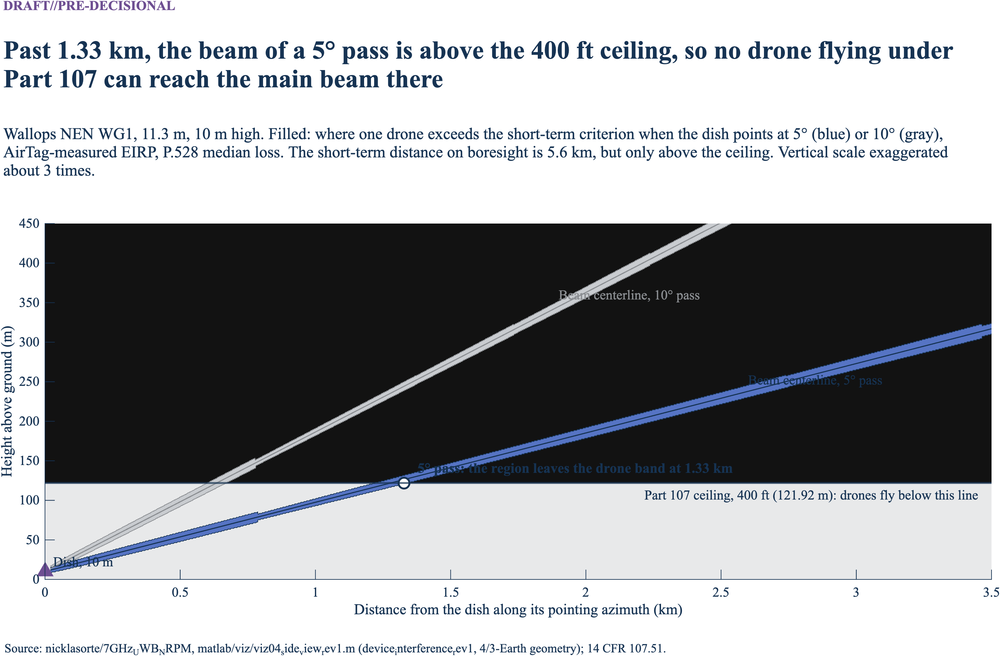

| Off-axis angle | Wallops gain | Wallops short-term | Wallops long-term | CCNY gain | CCNY short-term | CCNY long-term |
| --- | --- | --- | --- | --- | --- | --- |
| 0° (main beam, boresight) | 57.5 dBi | 5.6 km | 38 km | 44.0 dBi | 1.2 km | 8.3 km |
| 3 dB edge of the main beam (0.11° at Wallops; 0.53° at CCNY) | 54.5 dBi | 3.9 km | 27.5 km | 41.0 dBi | 840 m | 5.9 km |
| 0.5° (first sidelobes) | 39.5 dBi | 710 m | 5.0 km | 41.4 dBi (main beam) | 870 m | 6.1 km |
| 1° | 32.0 dBi | 300 m | 2.1 km | 33.4 dBi | 350 m | 2.5 km |
| 2° | 24.5 dBi | 125 m | 890 m | 26.3 dBi | 155 m | 1.1 km |
| 5° | 14.5 dBi | 40 m | 280 m | 16.4 dBi | 49 m | 350 m |
| 10° | 7.0 dBi | 17 m | 120 m | 8.8 dBi | 21 m | 150 m |
| 20° | -0.5 dBi | 7 m | 50 m | 1.3 dBi | 9 m | 62 m |
| 48° and beyond (back lobes) | -10 to -5 dBi | 2-4 m | 17-30 m | -8.2 dBi | 3 m | 21 m |

Patterns: ITU-R SA.509-3 at Wallops (D/λ about 308) and ITU-R F.699-5 at CCNY (D/λ about 65). Rev 0 reported a 42 km main-beam bound at the regulatory limit in free space; this table uses the measured EIRP and P.528 loss.


Four things follow from this table:

- **Main beam: the distance is out of reach beyond about 1.3 km.** The short-term distance on boresight is 5.6 km at Wallops, but a drone at 400 ft can only meet the boresight of a 5° pass out to 1.28 km; farther out, the beam passes above it. Inside 1.28 km, any drone in the main beam exceeds the short-term criterion while it transmits.
- **Sidelobes: the distance collapses within a few degrees.** One degree off boresight, a drone must be within about 300 m. At 5°, within 40-50 m. Beyond 20°, within 10 m.
- **The long-term criterion is out of reach for one drone at the cited duty cycles.** It allows 20% of the time. A drone that transmits less than 20% of the time can't exceed it alone at any distance. Only the short-term criterion is in play.
- **The beam moves.** The dish tracks the satellite, so a drone that is in the main beam at one moment isn't a few seconds later. At Wallops, a hovering drone at the best spot stays in the exceedance cone for about 8 seconds per pass (median over 556 passes in 30 days).

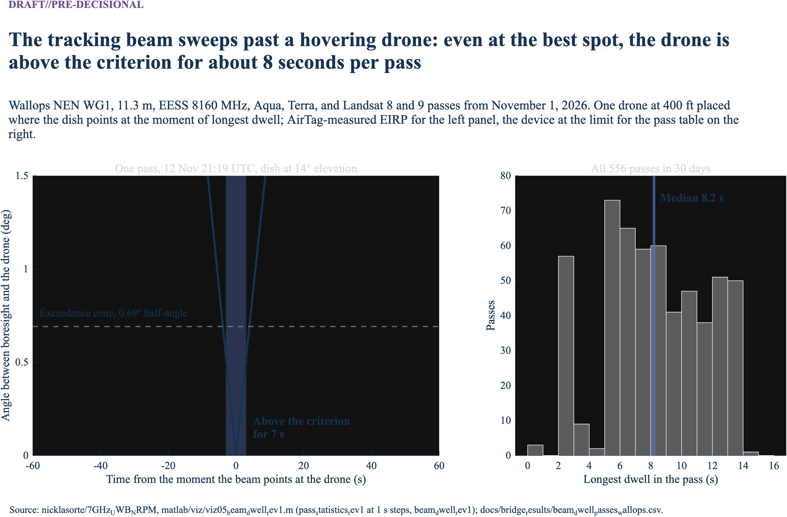

## Result: how long a drone has to stay that close

The short-term allowance is 0.005% of the time. Dividing by the duty cycle gives the time a drone must spend inside the short-term distance, in the direction the dish is pointing, to use it up (`docs/bridge_results/hours_to_allowance_*.csv`).

| Duty cycle | Source | Wallops, tracking-time basis | Wallops, all-time basis | Can one drone exceed the long-term criterion? |
| --- | --- | --- | --- | --- |
| 0.05% | ECC parking | 97 hours a year | 877 hours a year | No |
| 0.3% | ECC logistics | 16 hours | 146 hours | No |
| 1% | NPRM; ECC indoor | 4.9 hours | 44 hours | No |
| 5% | ECC maximum | 58 minutes | 8.8 hours | No |
| 100% | Bound | 2.9 minutes | 26 minutes | Yes |

At CCNY, the tracking-time values are about half these, because the dish tracks two satellites instead of four.

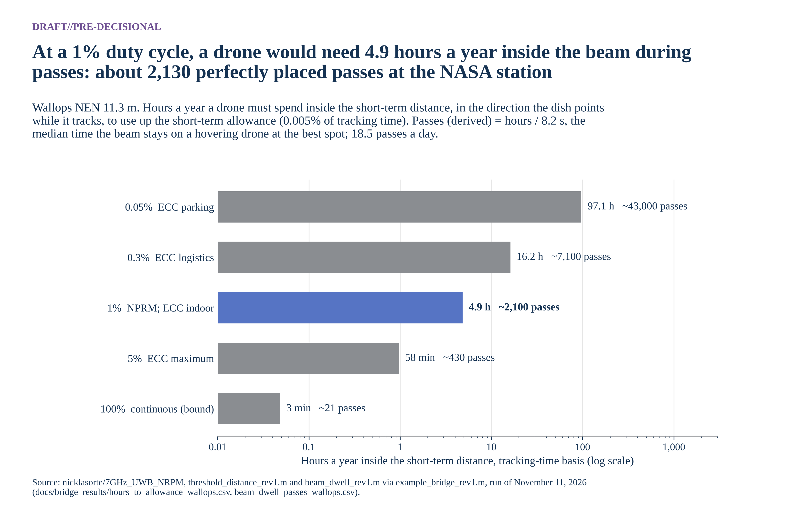

Combining the two gives the main-beam case in plain terms. At a 1% duty cycle, a drone at Wallops would need about 17,500 seconds in the main beam during passes. The beam stays on a well-placed hovering drone for about 8 seconds per pass, so it would take about 2,100 passes with the drone moved to exactly the right spot before each one (derived). At 18.5 passes a day, that's about 115 days of perfect positioning, every pass, at 400 ft within about 1.3 km of the dish. At 5%, it's about 430 passes, or 23 days.

**The answer at the NASA station:** a drone with a typical UWB device, at the duty cycles every study in this band assumes, causes interference above the ITU-R criteria only inside a main-beam region within about 1.3 km of the dish, or within tens of meters off the beam. It would have to hold that position, in the direction of the satellite, across thousands of passes a year to use up the short-term allowance, and it can't exceed the long-term criterion at all.

"""
## Result: from the worst case to normal conditions

The barbell (Figure 1) has two ends. The bridge in Figure 16 walks from one to the other at Wallops, one change at a time: from +43 dB for one drone following the beam at the device limit to -50 dB under normal conditions. The largest step, 55 dB, is going from a perfectly placed drone to random traffic. The two policy decisions are measured from normal conditions: counting over all time instead of tracking time gives -60 dB, and a 20 dB apportionment gives -34 dB. Both stay below the allowance.


Figure 17 ranks the inputs that could move the normal-conditions result. The widest bar is the 20 dB apportionment, which reaches -34 dB. No single input brings the result near the allowance.

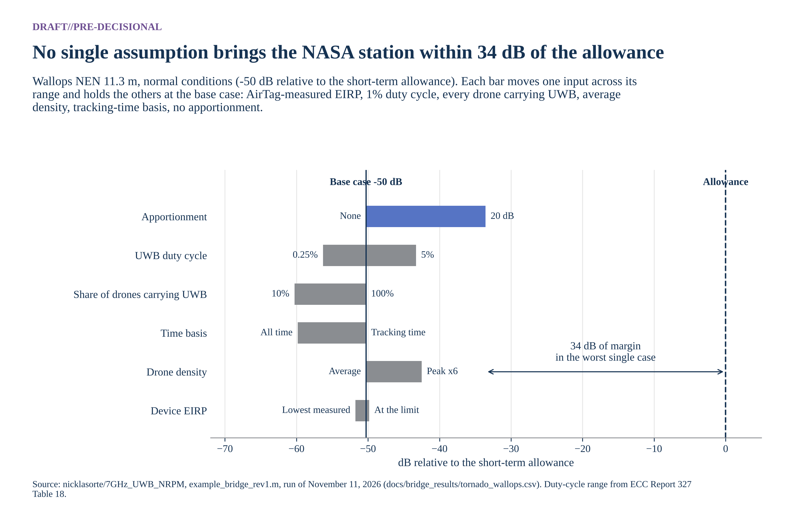

Figure 18 shows why the same model gives a different answer in Manhattan. Drone density is 140 times higher at CCNY, the single-drone footprint is 2.3 times larger, and the dish tracks about half as much of the time. The normal-conditions result is -50 dB at Wallops and -25 dB at CCNY.

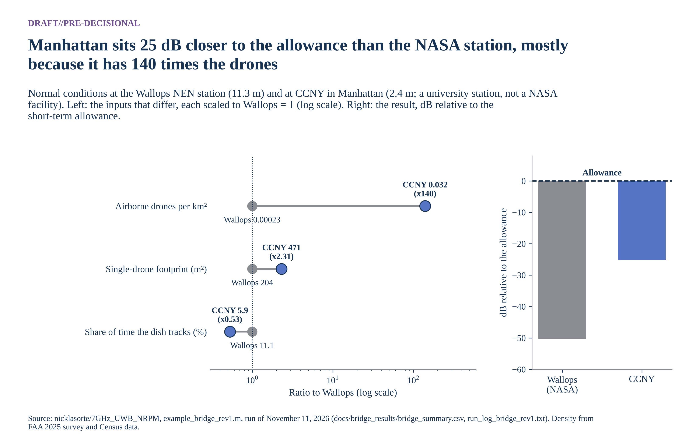

# What else is needed

| Item | Why it matters | Possible source |
| --- | --- | --- |
| Receiver bandwidth and required Eb/N0 for NEN receivers; G/T, noise temperature, bandwidth, and Eb/N0 for Landsat (NEN G/T is now from the NEN Users' Guide) | Converts thresholds to I/N and link margin | NASA SCaN, USGS EROS |
| Aperture efficiency and antenna height per site | ±1 dB on gain; changes near-in elevation geometry | NASA, USGS, NOAA |
| Earth station sites, including HRD terminals near population | Sets where geofences or channel limits would apply; Rev 1 runs one public site (CCNY) | NOAA OSPO, NASA DRL |
| Antenna height above ground and dome loss at each site | Sets main-beam geometry and the single-entry distance more than any other station input (step 11) | Station operators |
| Pass statistics (time at each elevation) | Converts pointing assumptions into percent-of-time | Mission operations |
| Site shielding and terrain masks | Can remove low-elevation exposure entirely | Site surveys |
| UWB drone use cases: altitude, packet on-time, ranging rate, channel, antenna pattern | Sets in-packet power, activity, and coupling | NPRM commenters, manufacturers, FiRa |
| Local drone traffic near earth stations | Drives the aggregate result about 1:1 in dB; Rev 1 builds a city-wide chain from FAA and Census data, but peak-hour factors and the share of drones carrying UWB have no public data | FAA Remote ID data, commenters |
| Apportionment of the criteria to UWB | ECC Report 327 used 20 dB; with it, the Mid density case at CCNY exceeds the EESS short-term criterion | NASA, NOAA, interagency agreement |
| Basis of the time percentages | Decides the High density case at CCNY (step 8) | NASA; joint assumptions agreement |
| Demodulator response to pulsed interference (LDPC, RS/convolutional) | Needed to judge pulse-resolved receivers | Laboratory measurement; NTIA ITS UWB testing in the 7 GHz band (NPRM fn. 40) |
| IEEE 802.15.4-2020 transmit mask text | Out-of-channel EESS (8236.8-8400 MHz) | IEEE standard |
| Text of US258 | Federal-non-federal status in 8025-8400 MHz | 47 CFR 2.106 |
| Air-to-ground propagation beyond LOS | Drones near the horizon | ITU-R P.528; ITM with terrain |

# Literature review

| Study | What it offers this problem | Limits |
| --- | --- | --- |
| NTIA Special Publication 01-43 (2001), *Assessment of Compatibility Between Ultrawideband Devices and Selected Federal Systems* | Federal method for UWB average and peak interference; analyses of fixed-satellite earth stations at 5° and 20° elevation and a 4 GHz earth station with average and peak power | Bands below 6 GHz; predates HRP UWB |
| NTIA Report 01-383 (2001), *The Temporal and Spectral Characteristics of Ultrawideband Signals* | Noise-like versus pulse-resolved regimes as a function of repetition rate and receiver bandwidth; dithering effects; aggregate tends toward Gaussian | Generic pulse waveforms, not 802.15.4z |
| ITU-R SM.1757 (2006) and Report ITU-R SM.2057 (2005) | International UWB impact studies; SM.2057 Annex 6 covers EESS, space research, and space operations; Annex 8 section 6.1 gives EESS protection characteristics | The EESS sections address 5 GHz active sensors, Earth-to-space links, and passive sensors, not 8 GHz space-to-Earth downlinks |
| ECC Report 64 (2005) | European generic UWB protection study | [CONFIRM: whether it covers 8 GHz EESS; not reviewed in full] |
| ECC Report 175 (2012) and ECC Decision (12)03 | Aircraft UWB study and the -64.3 dBm/MHz MetSat limit below 1000 m | GSO MetSat at 7.45-7.55 GHz only; EESS not studied; fuselage loss doesn't apply to drones |
| ECC Report 327 (via FiRa, 2025) | Activity factors by application (0.25% to 5%) | Ground and indoor applications, not airborne |
| FiRa Consortium, *UWB Simulation Report* (Roberson and Associates, 2025) | SEAMCAT Monte Carlo of outdoor and enhanced-power UWB against FSS earth stations (1.4 m and 3 m, 25 m height) and radars | Industry-commissioned; no EESS or MetSat analysis; ground devices only |
| Ely, Fuller, and Shaver (NASA Langley, 2002), *Ultrawideband Electromagnetic Interference to Aircraft Radios* | Field evidence that UWB pulses near -41 dBm EIRP affected aircraft receivers; dithered clocking mattered | Aviation receivers, not EESS |
| ITU-R SA.1026-5, SA.1027-6, SA.509-3 | Protection criteria and antenna pattern used here | Average-power criteria; no impulsive-interference guidance |
| JPSS-1 HRD-DBS RF ICD Rev A (2015) | JPSS HRD link parameters | Direct-broadcast terminal only |
| NTIA, *Spectrum Needs of U.S. Space-based Operations*, Appendix (2021) | Allocations and federal users in each band | Inventory, not analysis |

# Analytic next steps

These are options for the analysis, not policy recommendations.

1. Obtain NEN and Landsat receiver parameters and rerun the I/N columns.
2. Extend the site example to NASA's own stations, adding terrain and building blockage (ITM or P.452 with terrain) to the P.528 loss used at CCNY.
3. Agree on the apportionment and the time basis with NASA, then rerun the site examples once on the agreed basis.
4. Add in-packet power and activity statistics to the short-term Monte Carlo test.
5. Test candidate mitigations with the model: geofence radius, channel 9 exclusion for airborne use, an altitude cap, an EIRP cap in 7750-7900 and 8025-8400 MHz similar to ECC Decision (12)03, a duty-cycle cap, and downward-directed antennas.
6. Measure an 802.15.4z channel 9 emission through representative EESS and MetSat demodulators, in coordination with NTIA ITS.

[CONFIRM: recommendation]

# Appendix A: Code crosswalk

All code is at commit `1f608cf176d4833fd5dc30196deb00d098b909f5` of `nicklasorte/7GHz_UWB_NRPM`. Equations map to code as follows:

| Equation or step | Code |
| --- | --- |
| Main-beam distance, Equation 3 | [`main_beam_distance_rev1.m` L23](https://github.com/nicklasorte/7GHz_UWB_NRPM/blob/1f608cf176d4833fd5dc30196deb00d098b909f5/matlab/main_beam_distance_rev1.m#L23) |
| Boresight height, Equation 4 | [`main_beam_distance_rev1.m` L25](https://github.com/nicklasorte/7GHz_UWB_NRPM/blob/1f608cf176d4833fd5dc30196deb00d098b909f5/matlab/main_beam_distance_rev1.m#L25) |
| G0, phi0, phi2 (ITU-R SA.509-3) | [`sa509_gain_rev1.m` L26-L28](https://github.com/nicklasorte/7GHz_UWB_NRPM/blob/1f608cf176d4833fd5dc30196deb00d098b909f5/matlab/sa509_gain_rev1.m#L26-L28) |
| UWB EIRP in a victim bandwidth (mask integration, SM.337 FDR) | [`uwb_power_in_band_rev1.m` L35-L37](https://github.com/nicklasorte/7GHz_UWB_NRPM/blob/1f608cf176d4833fd5dc30196deb00d098b909f5/matlab/uwb_power_in_band_rev1.m#L35-L37) |
| Slant range and elevation on a 4/3 Earth | [`air_to_ground_geometry_rev1.m` L24-L25](https://github.com/nicklasorte/7GHz_UWB_NRPM/blob/1f608cf176d4833fd5dc30196deb00d098b909f5/matlab/air_to_ground_geometry_rev1.m#L24-L25) |
| Off-axis angle | [`uwb_to_es_interference_rev1.m` L21](https://github.com/nicklasorte/7GHz_UWB_NRPM/blob/1f608cf176d4833fd5dc30196deb00d098b909f5/matlab/uwb_to_es_interference_rev1.m#L21) |
| Free-space loss and link budget, Equations 1-2 | [`uwb_to_es_interference_rev1.m` L26-L29](https://github.com/nicklasorte/7GHz_UWB_NRPM/blob/1f608cf176d4833fd5dc30196deb00d098b909f5/matlab/uwb_to_es_interference_rev1.m#L26-L29) |
| In-packet boost and peak cap | [`uwb_pulse_metrics_rev1.m` L38](https://github.com/nicklasorte/7GHz_UWB_NRPM/blob/1f608cf176d4833fd5dc30196deb00d098b909f5/matlab/uwb_pulse_metrics_rev1.m#L38) |
| Regulatory peak envelope | [`uwb_pulse_metrics_rev1.m` L41](https://github.com/nicklasorte/7GHz_UWB_NRPM/blob/1f608cf176d4833fd5dc30196deb00d098b909f5/matlab/uwb_pulse_metrics_rev1.m#L41) |
| First-order peak-to-average | [`uwb_pulse_metrics_rev1.m` L51](https://github.com/nicklasorte/7GHz_UWB_NRPM/blob/1f608cf176d4833fd5dc30196deb00d098b909f5/matlab/uwb_pulse_metrics_rev1.m#L51) |
| Tsys from G/T | [`victim_systems_rev1.m` L83](https://github.com/nicklasorte/7GHz_UWB_NRPM/blob/1f608cf176d4833fd5dc30196deb00d098b909f5/matlab/victim_systems_rev1.m#L83) |
| Poisson drone count | [`aggregate_drone_mc_rev1.m` L52](https://github.com/nicklasorte/7GHz_UWB_NRPM/blob/1f608cf176d4833fd5dc30196deb00d098b909f5/matlab/aggregate_drone_mc_rev1.m#L52) |
| Aggregate for every geofence radius | [`aggregate_drone_mc_rev1.m` L75](https://github.com/nicklasorte/7GHz_UWB_NRPM/blob/1f608cf176d4833fd5dc30196deb00d098b909f5/matlab/aggregate_drone_mc_rev1.m#L75) |
| Percentile of exceedance | [`aggregate_drone_mc_rev1.m` L83](https://github.com/nicklasorte/7GHz_UWB_NRPM/blob/1f608cf176d4833fd5dc30196deb00d098b909f5/matlab/aggregate_drone_mc_rev1.m#L83) |
| Required radius | [`required_exclusion_radius_rev1.m` L16](https://github.com/nicklasorte/7GHz_UWB_NRPM/blob/1f608cf176d4833fd5dc30196deb00d098b909f5/matlab/required_exclusion_radius_rev1.m#L16) |

Rev 1 additions, at commit `c9ba260300083965b8ee3414b6286811c8ce6134`:

| Equation or step | Code |
| --- | --- |
| Site example, all 11 steps | [`example_station_ccny_rev1.m`](https://github.com/nicklasorte/7GHz_UWB_NRPM/blob/c9ba260300083965b8ee3414b6286811c8ce6134/matlab/example_station_ccny_rev1.m) |
| FAA and Census density chain, steps 1-4 | [`drone_density_faa_rev1.m` L50-L53](https://github.com/nicklasorte/7GHz_UWB_NRPM/blob/c9ba260300083965b8ee3414b6286811c8ce6134/matlab/drone_density_faa_rev1.m#L50-L53) |
| Order-statistic interval on a percentile | [`mc_tail_ci_rev1.m` L38](https://github.com/nicklasorte/7GHz_UWB_NRPM/blob/c9ba260300083965b8ee3414b6286811c8ce6134/matlab/mc_tail_ci_rev1.m#L38) |
| Clopper-Pearson interval on a time share | [`mc_tail_ci_rev1.m` L52](https://github.com/nicklasorte/7GHz_UWB_NRPM/blob/c9ba260300083965b8ee3414b6286811c8ce6134/matlab/mc_tail_ci_rev1.m#L52) |
| Short-path clutter rule | [`device_interference_rev1.m` L52-L53](https://github.com/nicklasorte/7GHz_UWB_NRPM/blob/c9ba260300083965b8ee3414b6286811c8ce6134/matlab/device_interference_rev1.m#L52-L53) |
| Poisson footprint prediction | [`exceedance_footprint_rev1.m` L76](https://github.com/nicklasorte/7GHz_UWB_NRPM/blob/c9ba260300083965b8ee3414b6286811c8ce6134/matlab/exceedance_footprint_rev1.m#L76) |
| 20 dB apportionment sensitivity | [`example_station_ccny_rev1.m` L171-L172](https://github.com/nicklasorte/7GHz_UWB_NRPM/blob/c9ba260300083965b8ee3414b6286811c8ce6134/matlab/example_station_ccny_rev1.m#L171-L172) |
| ECC Report 327 replica with ECC's fixed gain | [`ecc327_consistency_rev1.m` L88](https://github.com/nicklasorte/7GHz_UWB_NRPM/blob/c9ba260300083965b8ee3414b6286811c8ce6134/matlab/ecc327_consistency_rev1.m#L88) |
| Validated P.2108 terrestrial model | [`p2108_terrestrial_rev1.m`](https://github.com/nicklasorte/itu_p2108/blob/f3fc991/src/p2108_terrestrial_rev1.m) in `nicklasorte/itu_p2108` |

Call graph:

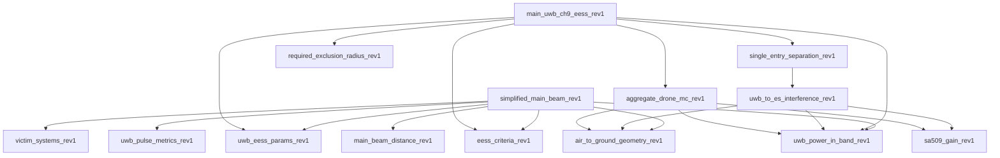

Checks performed (Rev 0): 11 unit tests (antenna pattern continuity, flat-Earth limit of the geometry, free-space loss formula, in-band power, criteria lookup, a hand link budget, Monte Carlo reproducibility and monotonicity, distance inversion, pulse metrics, Tsys derivation); an independent Python recomputation of the main-beam distances. Rev 1 has 24 unit tests in total (all passing in MATLAB R2025b), hand checks of the CCNY link budget and density chain, the Poisson footprint cross-check, and the ECC Report 327 calibration.

# Companion paper

All assumptions, with links and the questions NASA can answer, are in *Assumptions Register and NASA Red-Team Review* (`docs/assumptions_and_red_team_rev0.md`), which also quantifies the skeptic cases.

# Open verifications

- Federal Register publication date and comment deadlines for ET Docket No. 26-245.
- U.S. Table rows for 7550-7750 MHz and the text of US258.
- IEEE 802.15.4-2020 transmit PSD mask breakpoints.
- Aperture efficiency, G/T, receiver bandwidth, and required Eb/N0 for NEN and Landsat receivers.
- Whether ECC Report 64 addresses 8 GHz EESS.
- CCNY antenna height above ground, aperture efficiency, and dome loss (assumed 20 m, 0.6, and 0 dB).
- Whether NASA accepts a 20 dB apportionment of the SA.1027-6 criteria to UWB, as ECC Report 327 used.
- Duty cycles of drone-borne UWB: no measured data exist, because drones don't transmit UWB today; the assumption rests on the activity factors in ECC Report 327, CEPT Report 9, the FiRa report, and the NPRM.
- The share of drones that would carry channel 9 UWB (assumed 100%, a bound).
- Pulsed-interference tolerance data for the Landsat and JPSS demodulators.

# Flags

- The paper attributes a concern to NASA as reported by the requester; it states no NASA position.
- JPSS is a NOAA program; analysis of JPSS terminals may need NOAA coordination.
- The CCNY station is a university (NOAA-CREST) site, not a NASA facility. It is used only as a public example; any finding about it may need coordination with CUNY and NOAA.
- Whether ITU-R average-power criteria suffice for impulsive interference into wideband EESS receivers may need interagency technical agreement.

[^nprm]: FCC, *Modernization of Ultra-Wideband Technology Rules*, Notice of Proposed Rulemaking, ET Docket No. 26-245 (RM-11844, RM-12014) (rel. Oct. 1, 2026); FCC 26-66, Federal Register public inspection document 2026-22337, https://public-inspection.federalregister.gov/2026-22337.pdf; circulation draft at https://docs.fcc.gov/public/attachments/DOC-424842A1.pdf.
[^lw]: Latham & Watkins, *FCC Proposes UWB Rules Overhaul That Could Broaden Use for Drones*, https://www.lw.com/en/insights/fcc-proposes-uwb-rules-overhaul-that-could-broaden-use-for-drones.
[^ecc1203]: ECC Decision (12)03, *The harmonised conditions for UWB applications onboard aircraft* (approved Nov. 2, 2012; corrected Mar. 6, 2020), https://docdb.cept.org/download/1522.
[^ecc175]: ECC Report 175, *Co-existence study considering UWB applications inside aircraft and existing radio services in the frequency bands from 3.1 GHz to 4.8 GHz and from 6.0 GHz to 8.5 GHz* (Mar. 2012), https://docdb.cept.org/download/674.
[^107]: 14 CFR 107.51(b), https://www.law.cornell.edu/cfr/text/14/107.51.
[^chan]: IEEE Std 802.15.4 HRP UWB channel plan; see the overview at https://arxiv.org/pdf/2202.02190.
[^ntiaapp]: C. A. Cooper, *The Spectrum Needs of U.S. Space-based Operations: An Inventory of Current and Projected Uses*, Appendix "Allocations and Systems," NTIA (July 2021), https://www.ntia.gov/sites/default/files/publications/appendix-allocationsandsystems_0.pdf.
[^landsat]: USGS, *Landsat Data from Space to Earth*, https://www.usgs.gov/landsat-missions/landsat-data-space-earth; USGS publication 70193004, https://pubs.usgs.gov/publication/70193004.
[^jpssicd]: JPSS-1 Spacecraft High Rate Data (HRD) to Direct Broadcast Stations (DBS) RF ICD, Rev A, 470-REF-00184 (Feb. 9, 2015), https://www.nesdis.noaa.gov/s3/2022-03/JPSS-1SCHRDtoDBSRFICDRevA-470-REF-00184February9,2015.pdf; NOAA OSPO, *High Rate Data*, https://ospo.noaa.gov/operations/jpss/high-rate-data.html.
[^01383]: W. A. Kissick, ed., *The Temporal and Spectral Characteristics of Ultrawideband Signals*, NTIA Report 01-383 (Jan. 2001), https://www.its.ntia.gov/publications/download/TR-01-383.pdf.
[^crest]: CUNY CREST, *Satellite Receiving Station*, https://crest.cuny.edu/hires/research/facilities/satellite-receiving-station.
[^drl]: NASA Goddard Space Flight Center, Direct Readout Laboratory, *X-band station list*, entry 154, https://directreadout.sci.gsfc.nasa.gov/x-band.html.
[^faa]: FAA, *Small Unmanned Aircraft Systems Survey Report 2025*, Tables 1 and 6, https://www.faa.gov/data_research/aviation/aerospace_forecasts/Small-Unmanned-Aircraft-Systems-Survey-Report-2025.pdf.
[^census]: Census Bureau Vintage 2025 estimates, as tabulated in Cornell Program on Applied Demographics, *Vintage 2025 State Highlights*, https://pad.human.cornell.edu/papers/downloads/V2025StateHighlights.pdf.
[^nycdcp]: NYC Department of City Planning, *New York City Population Estimates and Trends* (March 2026), Appendix A, https://s-media.nyc.gov/agencies/dcp/assets/files/pdf/data-tools/population/population-estimates/new-york-city-population-estimates-and-trends-march-2026.pdf; land area from NYS Department of Health, *Vital Statistics 2020*, Table 2, https://healthweb-back.health.ny.gov/statistics/vital_statistics/2020/table02.htm.
[^faafcst]: FAA, *Aerospace Forecast FY2021-2041*, Unmanned Aircraft Systems chapter, https://www.faa.gov/sites/faa.gov/files/data_research/aviation/aerospace_forecasts/Unmanned_Aircraft_Systems.pdf.
[^fira]: FiRa Consortium, *UWB Simulation Report* (Roberson and Associates, 2025), summarizing ECC Report 327 Tables 1 and 18, https://www.firaconsortium.org/sites/default/files/2025-11/FiRa%20Ultra-Wideband%20Simulation%20Report.pdf.
[^ecc327]: ECC Report 327, *Technical studies to assess the feasibility of UWB applications in the 6-8.5 GHz band* (Oct. 2021), section 0.5.1, https://docdb.cept.org/download/3511.
[^airtag]: UL, *Test report 12791034-E2V3*, Apple AirTag, FCC ID BCGA2187, sections 8.1-8.2, https://fcc.report/FCC-ID/BCGA2187/5130980.pdf.
[^cept9]: CEPT Report 9, *Report from CEPT to the European Commission in response to the Mandate to: Harmonise radio spectrum use for Ultra-Wideband Systems in the European Union* (October 28, 2005), sections 2.2.2 and Annex 2, https://docdb.cept.org/download/9.
[^ecc94]: ECC Report 94, *Technical Requirements for UWB LDC Devices to Ensure the Protection of FWA Systems* (December 2006), sections 3 and 10, https://docdb.cept.org/download/421.
[^cfr519]: 47 CFR 15.519(a)(1), *Technical requirements for hand held UWB systems*, as published in the 2021 Code of Federal Regulations, https://www.govinfo.gov/content/pkg/CFR-2021-title47-vol1/pdf/CFR-2021-title47-vol1-part15.pdf.
