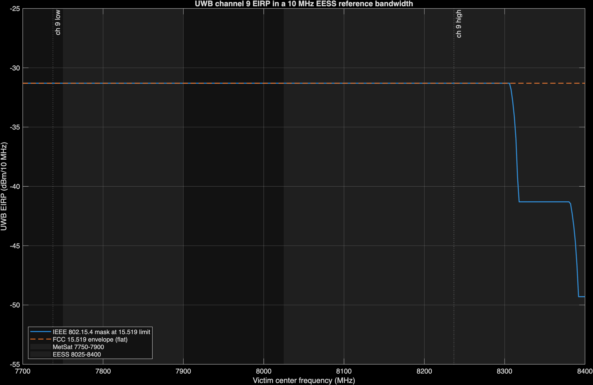
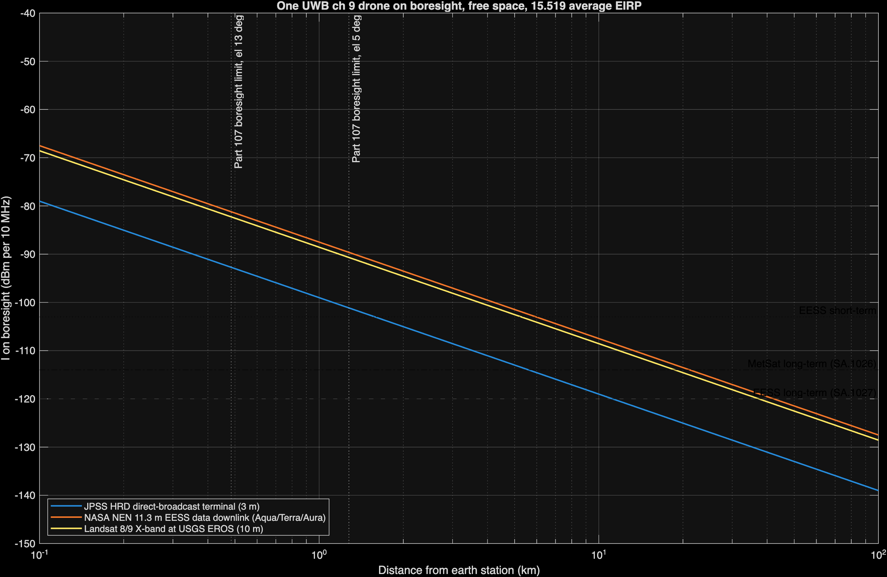
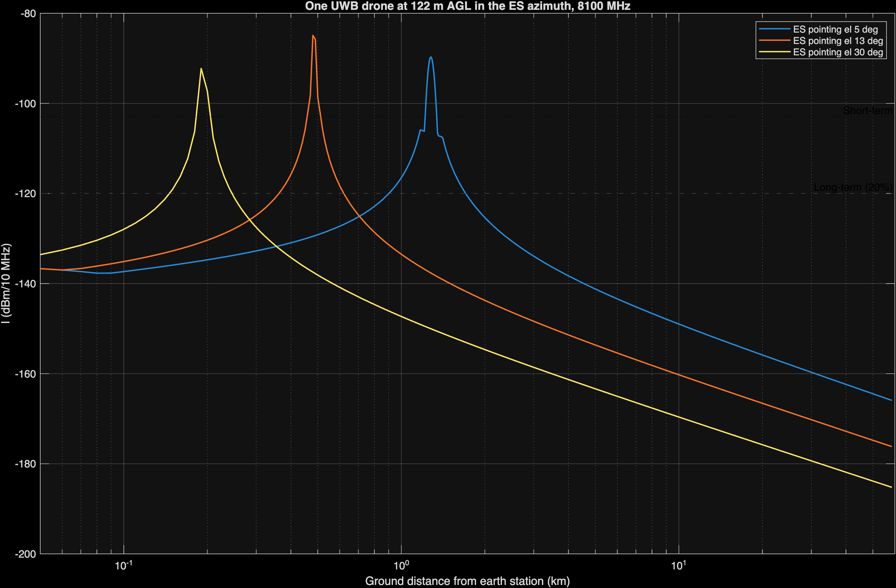
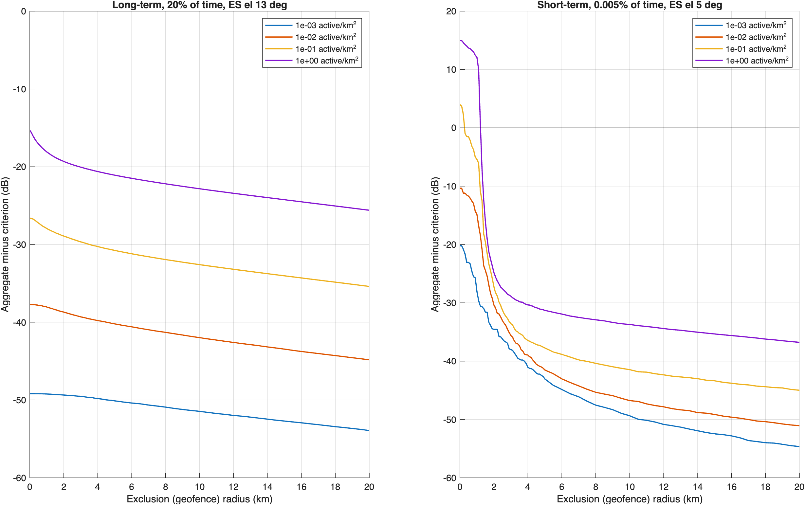
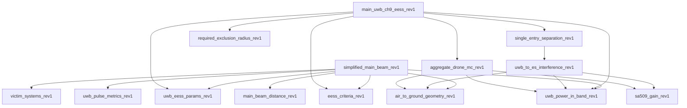

```
DRAFT - PRE-DECISIONAL AND DELIBERATIVE
Prepared with AI assistance. Reviewer: [CONFIRM]
Rule text as of: 2026-11-07
Analysis run: 2026-11-10
Public and cleared sources only.
```

# Overview

The Federal Communications Commission (FCC) Notice of Proposed Rulemaking (NPRM) on ultra-wideband (UWB) modernization, ET Docket No. 26-245, asks whether to relax the prohibition on UWB operation aboard aircraft in 47 CFR 15.521(a), and whether to permit UWB-based drone navigation and landing systems.[^nprm] NASA has raised concern that drones carrying IEEE 802.15.4 high-rate pulse (HRP) UWB radios on channel 9 could interfere with its Earth Exploration-Satellite Service (EESS) receive earth stations.

This paper does five things:

1. Identifies the space-to-Earth allocations and federal receive systems inside UWB channel 9 (7737.6-8236.8 MHz).
2. Collects public parameters for the UWB emission and for three candidate victim systems.
3. Calculates the distance at which one drone, in line of sight (LOS) and on the earth station boresight, reaches the applicable protection criteria, and then tests whether a drone can physically occupy that boresight.
4. Describes how the pulsed structure of the UWB emission appears inside each victim receiver and lists the data still needed.
5. Runs the full chain of calculations, step by step, at a real public X-band station in New York City, with drone density built from FAA data.

## What's new in Rev 1

- A site example at the CCNY NOAA-CREST X-band station in Manhattan, with each intermediate calculation shown (see "Site example: New York City").
- Drone density from FAA 2025 flight hours and Census population, replacing the assumed 0.1 and 1 per km² bracket.
- Confidence intervals on the short-term result, which Rev 0 left uncertain by about ±4 dB.
- Results on both time bases: all time and tracking time.
- The validated ITU-R P.2108 port for ground devices, with its effect separated into the formula fix and the short-path assumption.
- A consistency check against ECC Report 327 and measured channel 9 emissions from a shipping device.
- A table of the intermediate calculations NASA can check, and those that need NASA data.

The analysis is implemented in MATLAB in the public repository `nicklasorte/7GHz_UWB_NRPM`. Appendix A maps each equation to the code.

## Bottom line

- **The bounding distance is tens of kilometers.** With one UWB drone at the 47 CFR 15.519 average limit, in free space and on the boresight of a large EESS dish, the interference reaches the ITU-R long-term criterion at about 42 km for a 11.3 m NASA Near Earth Network (NEN) antenna and about 37 km for the 10 m Landsat antenna at USGS EROS. For a 3 m Joint Polar Satellite System (JPSS) direct-broadcast terminal at 7812 MHz, the distance is about 6 km.
- **Geometry limits where that can happen.** A drone at the 400 ft (121.92 m) ceiling in 14 CFR 107.51(b) can sit on a 5° boresight only within about 1.3 km of the dish, and on a 13° boresight only within about 0.5 km. To be on a 5° boresight at 42 km, the drone would need to be about 3.8 km above the dish.
- **Inside that ring, the excess is large.** A drone on a 5° boresight at the 1.3 km geometric limit exceeds the long-term EESS criterion by about 30 dB at the NEN and Landsat antennas and the MetSat criterion by about 13 dB at a JPSS terminal.
- **With a realistic antenna pattern,** one hovering drone at 121.92 m in the dish azimuth exceeds the long-term criterion out to about 1.7 km (5° pointing). In the aggregate Monte Carlo analysis, a geofence of 0.3 km protects the short-term criterion at 0.1 active drones per km², and 1.3 km is needed at 1 active drone per km².
- **The pulsed emission matters for wideband receivers.** The 30 MHz JPSS receiver is narrower than every HRP mean pulse repetition frequency (PRF), so UWB looks noise-like there. The 375 MHz Landsat receiver resolves individual pulses. The FCC 1 ms averaging rule also lets in-packet power run up to 7.3 dB above the long-term average, which extends the short-term distance by a factor of about 2.3.

{{bottom_line_rev1}}

These results are threshold distances against ITU-R sharing criteria. They aren't a finding of harmful interference as defined in 47 CFR 2.1, which depends on actual service degradation.

# Regulatory context

## The rulemaking

The NPRM was released October 1, 2026.[^lw] Paragraphs relevant to drones:

- **Paragraph 22** asks whether the 2002 prohibition on UWB aboard aircraft, ships, and satellites in § 15.521(a) remains warranted.
- **Paragraph 28** asks whether UWB-based autonomous drone navigation and landing systems should be permitted, and under what conditions, such as altitude limits, power limits, and duty-cycle limits.
- **Paragraph 29** asks about coexistence and safeguards such as geofencing and altitude-based restrictions.
- **Paragraph 30** asks supporters of expanded use to provide propagation modeling, link budgets, and coexistence studies. It states that the Commission doesn't intend drastic or wholesale changes to the air and space environments.
- **Paragraphs 37-38** propose a duty cycle under 1% in any 24-hour period for a new device category.
- **Paragraph 44** asks whether to allow installations up to 20 m to support low-altitude drone operations.
- **Footnote 63** gives the channel 9 center frequency, 7987.2 MHz.

The NPRM doesn't mention EESS or NASA. Comments are due 30 days after Federal Register publication, and replies 60 days after. [CONFIRM: Federal Register publication date and the resulting deadlines.]

## Current UWB rules

| Rule | Requirement |
| --- | --- |
| 47 CFR 15.519(c) | Average EIRP of -41.3 dBm/MHz in 3100-10600 MHz for handheld devices |
| 47 CFR 15.519(e) | Peak EIRP of 0 dBm in a 50 MHz bandwidth centered on the highest emission |
| 47 CFR 15.519 | No antennas mounted on outdoor structures; the device must be handheld |
| 47 CFR 15.521(a) | Operation aboard an aircraft, a ship, or a satellite is prohibited |
| 47 CFR 15.521(d) | Average limits are RMS measurements in a 1 MHz resolution bandwidth with 1 ms or less averaging time |
| 47 CFR 15.521(g) | With a resolution bandwidth (RBW) between 1 MHz and 50 MHz, the peak limit is 20 log (RBW/50) dBm |

## European precedent

ECC Decision (12)03 permits UWB aboard aircraft in 6.0-8.5 GHz at -41.3 dBm/MHz, but caps 7.75-7.9 GHz (meteorological satellite, MetSat) at -64.3 dBm/MHz when the aircraft is at or below 1000 m, and at -44.3 - 20 log10(10/x) dBm/MHz above 1000 m, where x is the height in kilometers.[^ecc1203] That is 23 dB below the U.S. handheld limit at low altitude. The supporting study, ECC Report 175, assumed two active devices per aircraft with 15 dB of fuselage attenuation downward, and it found that mitigation may be needed below 10,000 m to protect MetSat earth stations.[^ecc175] ECC Report 175 lists EESS at 8025-8400 MHz but doesn't analyze it. ECC Decision (06)04 excludes UWB in flying models and aviation. Drones carry no fuselage loss, so the European aircraft analysis understates the drone case.

## Drone altitude

14 CFR 107.51(b) limits small unmanned aircraft to 400 ft (121.92 m) above ground level, except within 400 ft of a structure.[^107] This paper uses 121.92 m as the drone ceiling. Operations above that height under waiver would extend main-beam coupling to longer distances (see "Simplified main-beam analysis").

# Spectrum overlap

## Allocations inside channel 9

IEEE 802.15.4 HRP channel 9 is centered at 7987.2 MHz with a 499.2 MHz bandwidth, so it spans 7737.6-8236.8 MHz.[^chan] The federal allocations below come from the NTIA space-spectrum inventory appendix (July 2021).[^ntiaapp]

| Band (MHz) | Overlap with ch 9 (MHz) | Primary allocations | Direction relevant here | Federal users named |
| --- | --- | --- | --- | --- |
| 7737.6-7750 | 12.4 | Fixed-satellite, mobile-satellite (space-to-Earth); fixed (secondary) | Space-to-Earth | DoD mission and TT&C [CONFIRM: 7550-7750 MHz row of the U.S. Table] |
| 7750-7900 | 150 | Meteorological-satellite (space-to-Earth); fixed | **Space-to-Earth** | NOAA: S-NPP, JPSS |
| 7900-8025 | 125 | Fixed-satellite, mobile-satellite (Earth-to-space); fixed (secondary) | Earth-to-space (satellite receives; out of scope) | DoD mission and TT&C |
| 8025-8175 | 150 | **EESS (space-to-Earth)**; fixed-satellite (Earth-to-space); fixed | **Space-to-Earth** | NASA: Aqua, Aura, Terra, NEN downlink antennas; NOAA: Jason-CS; DoD NGSO |
| 8175-8215 | 40 | **EESS (space-to-Earth)**; fixed-satellite and MetSat (Earth-to-space); fixed | **Space-to-Earth** | NASA: Aqua, Aura, Terra, NEN |
| 8215-8236.8 | 21.8 (of 185) | **EESS (space-to-Earth)**; fixed-satellite (Earth-to-space); fixed | **Space-to-Earth** | NASA: Aqua, Aura, Terra, NEN; NOAA: GOES-R series, S-NPP |

The 8025-8400 MHz rows carry U.S. footnote US258. [CITE: US258 text.]

```
MHz   7700      7800      7900      8000      8100      8200      8300      8400
       |---------|---------|---------|---------|---------|---------|---------|
UWB ch 9      [7737.6 ======================= 7987.2 ======================= 8236.8]
IEEE mask     0 dBr to +/-324.5 MHz, -10 dBr to +/-399.4 MHz, -18 dBr beyond
MetSat s-E      [7750 ===== 7900]                    JPSS HRD at 7812
E-s uplinks                    [7900 ==== 8025]
EESS s-E                                 [8025 ===================================== 8400]
                                         Aqua 8160, Terra/Landsat 8212.5
```



## What NASA is likely concerned about

Two space-to-Earth bands fall inside channel 9 at the full in-channel power:

- **EESS, 8025-8400 MHz.** 211.8 MHz of the 375 MHz band is inside the channel. This band carries NASA Earth science data downlinks (Aqua, Aura, Terra) to NEN antennas, direct-broadcast downlinks received by many university and agency terminals, and the Landsat 8 and 9 downlink, which USGS operates and which fills the full 375 MHz.[^landsat] The rest of the band, 8236.8-8400 MHz, sees the channel skirt at -10 dBr to -18 dBr (IEEE mask) or the full -41.3 dBm/MHz (FCC envelope).
- **MetSat, 7750-7900 MHz.** The entire band is inside the channel. JPSS satellites, which NASA builds for NOAA, transmit High Rate Data (HRD) at 7812 MHz to direct-broadcast terminals, and NASA's Direct Readout Laboratory supports those users.[^jpssicd]

This paper analyzes one representative receiver for each case, plus Landsat because its receiver bandwidth makes the pulse question sharpest.

# Candidate victim systems

| Parameter | JPSS HRD terminal | NASA NEN EESS antenna | Landsat 8/9 at USGS EROS |
| --- | --- | --- | --- |
| Service and band | MetSat (s-E), 7750-7900 MHz | EESS (s-E), 8025-8400 MHz | EESS (s-E), 8025-8400 MHz |
| Center frequency | 7812 MHz | 8160 MHz (Aqua) | 8212.5 MHz (fills the band) |
| Receiver bandwidth | 30 MHz assigned | [CONFIRM] | 375 MHz |
| Data rate and coding | 15 Mbps (25 Mbps from NOAA-21); QPSK; RS(255,223) + rate-1/2 convolutional | [CONFIRM] | 384 Mbps; rate-7/8 LDPC |
| Antenna diameter | 3 m (reference) | 11.3 m | 10 m |
| Main-beam gain G0 | 45.6 dBi (derived, eta = 0.6) | 57.5 dBi published for 11.3 m (SG1); 57.48 dBi derived | 56.5 dBi (derived, eta = 0.6) |
| G/T | 22.7 dB/K at 5° | 35.2 dB/K (AS1, Fairbanks), 34.5 dB/K (WG1, Wallops), at 10° | [CONFIRM] |
| System noise temperature | 194 K (derived from G/T and G0) | 170 K (AS1), 200 K (WG1), derived | [CONFIRM] |
| Polarization | RHCP | RHC/LHC selectable | [CONFIRM] |
| Minimum elevation | 5° | 5° | 5° |
| Required Eb/N0; minimum margin | 4.4 dB; 1 dB | [CONFIRM] | [CONFIRM] |
| Sites | 47 registered HRD users | Fairbanks AK, Wallops VA; commercial NEN at North Pole AK, South Point HI | Sioux Falls SD; Gilmore Creek AK |
| Source | JPSS-1 HRD-DBS RF ICD Rev A; NOAA OSPO | NEN Users' Guide, 453-NENUG Rev 5, Tables 2-1 and 3-3 | USGS |

The main-beam gain is G0 = 10 log10(eta (pi D/lambda)^2) from ITU-R SA.509-3, with an assumed aperture efficiency eta of 0.6. [CONFIRM: aperture efficiency for each antenna.] The 3 m JPSS antenna has D/lambda of about 78, below the D/lambda >= 100 range of the SA.509-3 sidelobe pattern, so the paper uses only its main-beam gain.

# UWB characteristics in channel 9

| Characteristic | Value | Source |
| --- | --- | --- |
| Center frequency, bandwidth | 7987.2 MHz, 499.2 MHz | IEEE 802.15.4 HRP; NPRM fn. 63 |
| Average EIRP | -41.3 dBm/MHz, RMS over 1 ms or less | 47 CFR 15.519(c), 15.521(d) |
| Average EIRP in 10 MHz (in-channel) | -31.3 dBm | Derived |
| Peak EIRP | 0 dBm in 50 MHz; 20 log (RBW/50) dBm for RBW 1-50 MHz | 47 CFR 15.519(e), 15.521(g) |
| Transmit PSD mask | 0 dBr within 0.65/Tp, -10 dBr to 0.8/Tp, -18 dBr beyond (1/Tp = 499.2 MHz) | IEEE 802.15.4 [CONFIRM: 2020 breakpoints] |
| Mean PRF | 62.4 MHz (BPRF); 124.8 or 249.6 MHz (HPRF) | IEEE 802.15.4z; MathWorks `lrwpanHRPConfig` |
| Peak PRF (chip rate in a burst) | 499.2 MHz (about 2 ns per chip) | IEEE 802.15.4 |
| Packet on-time | Not public for drone use; swept 0.1-1 ms | [CONFIRM] |
| Activity factor | 0.25% to 5% by application (ECC Report 327 Table 18); NPRM proposes under 1% per 24 hours for a new category | ECC Report 327 via FiRa (2025); NPRM paras. 37-38 |
| Antenna | Isotropic at the limit (no downward-directed pattern assumed) | Assumption; NPRM para. 29 |
| Polarization loss into a circular feed | 3 dB | cos^2(45°) |

# Pulsed nature of the UWB emission

A UWB HRP transmitter emits bursts of roughly 2 ns chips. How that energy appears in a federal receiver depends on three time scales: the pulse spacing (1/PRF), the receiver's impulse response (about 1/B for receiver bandwidth B), and the packet on-time.

## Noise-like and pulse-resolved regimes

NTIA Report 01-383 shows that when the pulse repetition rate exceeds the receiver bandwidth, overlapping pulse responses add to an approximately Gaussian, noise-like signal. When the receiver bandwidth is much larger than the repetition rate, the receiver resolves individual pulses, and Gaussian-based statistics no longer apply.[^01383] Dithering spreads the energy into a continuous spectrum; without it, the energy concentrates in spectral lines at multiples of the PRF. HRP UWB scrambles its pulses, so this paper treats the spectrum as continuous.

| Victim receiver | Bandwidth | BPRF 62.4 MHz | HPRF 124.8 MHz | HPRF 249.6 MHz |
| --- | --- | --- | --- | --- |
| JPSS HRD | 30 MHz | Noise-like | Noise-like | Noise-like |
| ITU-R reference bandwidth | 10 MHz | Noise-like | Noise-like | Noise-like |
| Landsat 8/9 | 375 MHz | Pulse-resolved, about 7.8 dB first-order peak-to-average | Pulse-resolved, about 4.8 dB | Pulse-resolved, about 1.8 dB |

The first-order peak-to-average ratio for a resolved pulse train is 10 log10(B/PRF). It omits pulse shape and the burst structure of BPRF, in which several chips at the 499.2 MHz peak PRF arrive together, so the burst, not the chip, may be the resolved event in a 375 MHz receiver. Measurement is needed to settle the actual value.

## The regulatory peak envelope

The rules allow a peak-to-average ratio well above the first-order value. With the peak limit scaled by 20 log (B/50) and the average by 10 log (B):

| Receiver bandwidth | Average EIRP | Peak envelope | Allowed peak-to-average |
| --- | --- | --- | --- |
| 1 MHz | -41.3 dBm | -34.0 dBm | 7.3 dB |
| 10 MHz | -31.3 dBm | -14.0 dBm | 17.3 dB |
| 30 MHz | -26.5 dBm | -4.4 dBm | 22.1 dB |
| 375 MHz | -15.6 dBm | 17.5 dBm | 33.1 dB (20 log extrapolated beyond 50 MHz) |

The 20 log scaling is defined in § 15.521(g) only for 1-50 MHz; the 375 MHz row is an extrapolation and an upper bound.

## In-packet power

The average limit is an RMS value over 1 ms or less. A packet shorter than 1 ms, alone in its 1 ms window, can therefore run at 10 log10(1 ms / t_on) above the limit while it transmits. The peak limit caps that boost: the in-packet average in 1 MHz can't exceed the 1 MHz peak limit of -34.0 dBm, so the boost is at most 7.3 dB.

| Packet on-time | Requested boost | Allowed boost |
| --- | --- | --- |
| 0.1 ms | 10.0 dB | 7.3 dB |
| 0.25 ms | 6.0 dB | 6.0 dB |
| 1 ms | 0 dB | 0 dB |

## What this means for the protection criteria

- **Long-term criterion (20% of time).** A drone that is active only a few percent of the time contributes its in-packet power for that fraction. With an activity factor below 20%, one drone can't cause a 20% exceedance by itself; the long-term criterion then becomes an aggregate question (many drones) or a hovering-drone question at high activity.
- **Short-term criterion (0.005% for EESS, 0.0125% for MetSat).** 0.005% of a year is about 26 minutes. A single drone transmitting at in-packet power for that long is plausible, so the short-term test should use in-packet power, not the 1 ms average.
- **Wideband receivers.** For a pulse-resolved receiver such as Landsat, the effect of interference on a rate-7/8 LDPC decoder depends on peak amplitude and pulse statistics, not average power alone. ITU-R SA.1027-6 states its criteria as average power and doesn't address impulsive interference. [CONFIRM: whether NASA or USGS have pulsed-interference tolerance data for these demodulators.]

# Protection criteria

| Band | Long term | Short term | Source |
| --- | --- | --- | --- |
| EESS 8025-8400 MHz | -150 dBW per 10 MHz, not exceeded more than 20% of time | -133 dBW per 10 MHz, not exceeded more than 0.005% | ITU-R SA.1027-6, terrestrial-path share |
| MetSat 7750-7900 MHz | -144 dBW per 10 MHz, 20% | -127 dBW per 10 MHz, 0.0125% | ITU-R SA.1026-5, aggregate from all sources |

The criteria apply at the antenna output. ITU-R SA.1027-6 Note 4 applies the terrestrial-path criteria to transmitting terrestrial stations, which includes a drone. ITU-R SA.1026-5 Table 2 uses 13° elevation for the long-term case and 5° for the short-term case at 8 GHz. With a 150 K system noise temperature, the EESS long-term criterion corresponds to I/N of about -13 dB.

The paper also reports distances at I/N = -6 dB and -10 dB in the actual receiver bandwidth where the noise temperature is known (JPSS).

# Simplified main-beam analysis

## Method

One drone is in LOS, on the earth station boresight, at the full average EIRP, with free-space loss and no clutter or shielding. The interference at the antenna output is

```
I = EIRP_B - FSPL(d, f) + G0 - L_pol                                  (1)
FSPL(d, f) = 20 log10(4 pi d / lambda)                                 (2)
```

where `EIRP_B` is the UWB EIRP in the victim bandwidth B. Setting I equal to the threshold `I_th` and solving for distance gives

```
d = (lambda / 4 pi) * 10^((EIRP_B + G0 - L_pol - I_th) / 20)            (3)
```

For the drone to be on a boresight at elevation `el` and distance d on a 4/3 Earth, its height above the dish must be

```
h = d tan(el) + d^2 / (2 k Re),  k = 4/3, Re = 6371 km                  (4)
```

The highest Part 107 drone is 111.92 m above a dish center at 10 m. Solving Equation 4 for that height gives the farthest distance at which boresight coupling is possible.

## Results

All distances use the in-channel EIRP of -31.3 dBm per 10 MHz and 3 dB polarization loss.

| Victim | G0 | Long-term distance | Short-term distance | Short-term, in-packet (+7.3 dB) | I/N = -6 dB | I/N = -10 dB |
| --- | --- | --- | --- | --- | --- | --- |
| JPSS HRD, 3 m, 7812 MHz | 45.6 dBi | 5.6 km | 0.8 km | 1.8 km | 4.3 km | 6.8 km |
| NASA NEN, 11.3 m, 8160 MHz | 57.5 dBi | 42.2 km | 6.0 km | 13.8 km | [CONFIRM: Tsys] | [CONFIRM: Tsys] |
| Landsat at EROS, 10 m, 8212.5 MHz | 56.5 dBi | 37.3 km | 5.3 km | 12.2 km | [CONFIRM: Tsys] | [CONFIRM: Tsys] |

| Dish pointing elevation | Farthest boresight distance for a 121.92 m drone | Height needed at the NEN long-term distance (42.2 km) |
| --- | --- | --- |
| 5° | 1.28 km | about 3.8 km |
| 13° | 0.48 km | about 9.8 km |

| Victim | Excess over the long-term criterion, drone on a 5° boresight at 1.28 km | On a 13° boresight at 0.48 km |
| --- | --- | --- |
| JPSS HRD | 12.8 dB | 21.0 dB |
| NASA NEN | 30.3 dB | 38.6 dB |
| Landsat at EROS | 29.3 dB | 37.5 dB |



## Interpretation

The free-space main-beam distance is a bound, not a prediction. It answers how far away a drone could be and still matter if it were on boresight. For drones that stay at or below 400 ft, boresight coupling happens only inside a ring of about 1.3 km during low-elevation passes, and inside that ring the excess is large. For drones above 400 ft, under waiver or a future rule, the bound becomes reachable: a drone at 1 km altitude is on a 5° boresight at about 11 km, inside every long-term distance in the table.

# Higher-fidelity analysis

The repository also implements two analyses that replace the main-beam assumption with the ITU-R SA.509-3 antenna pattern and real geometry. Both use the NEN 11.3 m antenna at 8100 MHz.

## Single drone, worst-case azimuth

One drone hovers in the dish azimuth at a set altitude while the dish points at a fixed elevation. The analysis sweeps ground distance and uses the SA.509-3 single-entry pattern.

| Drone altitude | Long-term separation, el 5° | el 13° | el 30° |
| --- | --- | --- | --- |
| 30 m | 0.58 km | 0.20 km | 0.08 km |
| 60 m | 0.96 km | 0.34 km | 0.14 km |
| 121.92 m | 1.71 km | 0.63 km | 0.25 km |



At 7800 MHz (MetSat, same antenna), the long-term separation at 121.92 m is 1.53 km at 5°.

## Aggregate Monte Carlo

Each Monte Carlo iteration draws a Poisson number of active drones, uniform in area out to the 58.5 km radio horizon and uniform in altitude from 10 m to 121.92 m, with a random dish azimuth. Interference is summed in milliwatts with the SA.509-3 multiple-entry pattern for every candidate geofence radius at once. The long-term runs use 13° pointing and 20,000 iterations; the short-term runs use 5° pointing and 200,000 iterations, which leaves about 10 samples beyond the 0.005% point. The active density is the drone density times the UWB activity factor.

| Active drones per km² | Required geofence radius | Long-term margin with no geofence | Short-term margin with no geofence | Highest EIRP with no geofence |
| --- | --- | --- | --- | --- |
| 0.001 | 0 km | -49.2 dB | -20.2 dB | -41.3 dBm/MHz |
| 0.01 | 0 km | -37.7 dB | -10.4 dB | -41.3 dBm/MHz |
| 0.1 | 0.3 km | -26.6 dB | +4.0 dB | -45.3 dBm/MHz |
| 1 | 1.3 km | -15.3 dB | +15.0 dB | -56.3 dBm/MHz |



Negative margin means the criterion is met. The short-term criterion governs at every density. The aggregate runs use the 1 ms average EIRP; using in-packet power for the short-term test adds up to 7.3 dB to the short-term margins.

# What else is needed

| Item | Why it matters | Possible source |
| --- | --- | --- |
| Receiver bandwidth and required Eb/N0 for NEN receivers; G/T, noise temperature, bandwidth, and Eb/N0 for Landsat (NEN G/T is now from the NEN Users' Guide) | Converts thresholds to I/N and link margin | NASA SCaN, USGS EROS |
| Aperture efficiency and antenna height per site | ±1 dB on gain; changes near-in elevation geometry | NASA, USGS, NOAA |
| Earth station sites, including HRD terminals near population | Sets where geofences or channel limits would apply | NOAA OSPO, NASA DRL |
| Pass statistics (time at each elevation) | Converts pointing assumptions into percent-of-time | Mission operations |
| Site shielding and terrain masks | Can remove low-elevation exposure entirely | Site surveys |
| UWB drone use cases: altitude, packet on-time, ranging rate, channel, antenna pattern | Sets in-packet power, activity, and coupling | NPRM commenters, manufacturers, FiRa |
| Drone density forecasts near earth stations | Drives the aggregate result about 1:1 in dB | FAA forecasts, commenters |
| Demodulator response to pulsed interference (LDPC, RS/convolutional) | Needed to judge pulse-resolved receivers | Laboratory measurement; NTIA ITS UWB testing in the 7 GHz band (NPRM fn. 40) |
| IEEE 802.15.4-2020 transmit mask text | Out-of-channel EESS (8236.8-8400 MHz) | IEEE standard |
| Text of US258 | Federal-non-federal status in 8025-8400 MHz | 47 CFR 2.106 |
| Air-to-ground propagation beyond LOS | Drones near the horizon | ITU-R P.528; ITM with terrain |

# Literature review

| Study | What it offers this problem | Limits |
| --- | --- | --- |
| NTIA Special Publication 01-43 (2001), *Assessment of Compatibility Between Ultrawideband Devices and Selected Federal Systems* | Federal method for UWB average and peak interference; analyses of fixed-satellite earth stations at 5° and 20° elevation and a 4 GHz earth station with average and peak power | Bands below 6 GHz; predates HRP UWB |
| NTIA Report 01-383 (2001), *The Temporal and Spectral Characteristics of Ultrawideband Signals* | Noise-like versus pulse-resolved regimes as a function of repetition rate and receiver bandwidth; dithering effects; aggregate tends toward Gaussian | Generic pulse waveforms, not 802.15.4z |
| ITU-R SM.1757 (2006) and Report ITU-R SM.2057 (2005) | International UWB impact studies; SM.2057 Annex 6 covers EESS, space research, and space operations; Annex 8 section 6.1 gives EESS protection characteristics | The EESS sections address 5 GHz active sensors, Earth-to-space links, and passive sensors, not 8 GHz space-to-Earth downlinks |
| ECC Report 64 (2005) | European generic UWB protection study | [CONFIRM: whether it covers 8 GHz EESS; not reviewed in full] |
| ECC Report 175 (2012) and ECC Decision (12)03 | Aircraft UWB study and the -64.3 dBm/MHz MetSat limit below 1000 m | GSO MetSat at 7.45-7.55 GHz only; EESS not studied; fuselage loss doesn't apply to drones |
| ECC Report 327 (via FiRa, 2025) | Activity factors by application (0.25% to 5%) | Ground and indoor applications, not airborne |
| FiRa Consortium, *UWB Simulation Report* (Roberson and Associates, 2025) | SEAMCAT Monte Carlo of outdoor and enhanced-power UWB against FSS earth stations (1.4 m and 3 m, 25 m height) and radars | Industry-commissioned; no EESS or MetSat analysis; ground devices only |
| Ely, Fuller, and Shaver (NASA Langley, 2002), *Ultrawideband Electromagnetic Interference to Aircraft Radios* | Field evidence that UWB pulses near -41 dBm EIRP affected aircraft receivers; dithered clocking mattered | Aviation receivers, not EESS |
| ITU-R SA.1026-5, SA.1027-6, SA.509-3 | Protection criteria and antenna pattern used here | Average-power criteria; no impulsive-interference guidance |
| JPSS-1 HRD-DBS RF ICD Rev A (2015) | JPSS HRD link parameters | Direct-broadcast terminal only |
| NTIA, *Spectrum Needs of U.S. Space-based Operations*, Appendix (2021) | Allocations and federal users in each band | Inventory, not analysis |

# Analytic next steps

These are options for the analysis, not policy recommendations.

1. Obtain NEN and Landsat receiver parameters and rerun the I/N columns.
2. Run the aggregate model at each real earth station location with terrain (ITM) and real pass statistics.
3. Add in-packet power and activity statistics to the short-term Monte Carlo test.
4. Test candidate mitigations with the model: geofence radius, channel 9 exclusion for airborne use, an altitude cap, an EIRP cap in 7750-7900 and 8025-8400 MHz similar to ECC Decision (12)03, a duty-cycle cap, and downward-directed antennas.
5. Measure an 802.15.4z channel 9 emission through representative EESS and MetSat demodulators, in coordination with NTIA ITS.

[CONFIRM: recommendation]

# Appendix A: Code crosswalk

All code is at commit `1f608cf176d4833fd5dc30196deb00d098b909f5` of `nicklasorte/7GHz_UWB_NRPM`. Equations map to code as follows:

| Equation or step | Code |
| --- | --- |
| Main-beam distance, Equation 3 | [`main_beam_distance_rev1.m` L23](https://github.com/nicklasorte/7GHz_UWB_NRPM/blob/1f608cf176d4833fd5dc30196deb00d098b909f5/matlab/main_beam_distance_rev1.m#L23) |
| Boresight height, Equation 4 | [`main_beam_distance_rev1.m` L25](https://github.com/nicklasorte/7GHz_UWB_NRPM/blob/1f608cf176d4833fd5dc30196deb00d098b909f5/matlab/main_beam_distance_rev1.m#L25) |
| G0, phi0, phi2 (ITU-R SA.509-3) | [`sa509_gain_rev1.m` L26-L28](https://github.com/nicklasorte/7GHz_UWB_NRPM/blob/1f608cf176d4833fd5dc30196deb00d098b909f5/matlab/sa509_gain_rev1.m#L26-L28) |
| UWB EIRP in a victim bandwidth (mask integration, SM.337 FDR) | [`uwb_power_in_band_rev1.m` L35-L37](https://github.com/nicklasorte/7GHz_UWB_NRPM/blob/1f608cf176d4833fd5dc30196deb00d098b909f5/matlab/uwb_power_in_band_rev1.m#L35-L37) |
| Slant range and elevation on a 4/3 Earth | [`air_to_ground_geometry_rev1.m` L24-L25](https://github.com/nicklasorte/7GHz_UWB_NRPM/blob/1f608cf176d4833fd5dc30196deb00d098b909f5/matlab/air_to_ground_geometry_rev1.m#L24-L25) |
| Off-axis angle | [`uwb_to_es_interference_rev1.m` L21](https://github.com/nicklasorte/7GHz_UWB_NRPM/blob/1f608cf176d4833fd5dc30196deb00d098b909f5/matlab/uwb_to_es_interference_rev1.m#L21) |
| Free-space loss and link budget, Equations 1-2 | [`uwb_to_es_interference_rev1.m` L26-L29](https://github.com/nicklasorte/7GHz_UWB_NRPM/blob/1f608cf176d4833fd5dc30196deb00d098b909f5/matlab/uwb_to_es_interference_rev1.m#L26-L29) |
| In-packet boost and peak cap | [`uwb_pulse_metrics_rev1.m` L38](https://github.com/nicklasorte/7GHz_UWB_NRPM/blob/1f608cf176d4833fd5dc30196deb00d098b909f5/matlab/uwb_pulse_metrics_rev1.m#L38) |
| Regulatory peak envelope | [`uwb_pulse_metrics_rev1.m` L41](https://github.com/nicklasorte/7GHz_UWB_NRPM/blob/1f608cf176d4833fd5dc30196deb00d098b909f5/matlab/uwb_pulse_metrics_rev1.m#L41) |
| First-order peak-to-average | [`uwb_pulse_metrics_rev1.m` L51](https://github.com/nicklasorte/7GHz_UWB_NRPM/blob/1f608cf176d4833fd5dc30196deb00d098b909f5/matlab/uwb_pulse_metrics_rev1.m#L51) |
| Tsys from G/T | [`victim_systems_rev1.m` L83](https://github.com/nicklasorte/7GHz_UWB_NRPM/blob/1f608cf176d4833fd5dc30196deb00d098b909f5/matlab/victim_systems_rev1.m#L83) |
| Poisson drone count | [`aggregate_drone_mc_rev1.m` L52](https://github.com/nicklasorte/7GHz_UWB_NRPM/blob/1f608cf176d4833fd5dc30196deb00d098b909f5/matlab/aggregate_drone_mc_rev1.m#L52) |
| Aggregate for every geofence radius | [`aggregate_drone_mc_rev1.m` L75](https://github.com/nicklasorte/7GHz_UWB_NRPM/blob/1f608cf176d4833fd5dc30196deb00d098b909f5/matlab/aggregate_drone_mc_rev1.m#L75) |
| Percentile of exceedance | [`aggregate_drone_mc_rev1.m` L83](https://github.com/nicklasorte/7GHz_UWB_NRPM/blob/1f608cf176d4833fd5dc30196deb00d098b909f5/matlab/aggregate_drone_mc_rev1.m#L83) |
| Required radius | [`required_exclusion_radius_rev1.m` L16](https://github.com/nicklasorte/7GHz_UWB_NRPM/blob/1f608cf176d4833fd5dc30196deb00d098b909f5/matlab/required_exclusion_radius_rev1.m#L16) |

Call graph:



Checks performed: 11 unit tests (antenna pattern continuity, flat-Earth limit of the geometry, free-space loss formula, in-band power, criteria lookup, a hand link budget, Monte Carlo reproducibility and monotonicity, distance inversion, pulse metrics, Tsys derivation); an independent Python recomputation of the main-beam distances.

# Companion paper

All assumptions, with links and the questions NASA can answer, are in *Assumptions Register and NASA Red-Team Review* (`docs/assumptions_and_red_team_rev0.md`), which also quantifies the skeptic cases.

# Open verifications

- Federal Register publication date and comment deadlines for ET Docket No. 26-245.
- U.S. Table rows for 7550-7750 MHz and the text of US258.
- IEEE 802.15.4-2020 transmit PSD mask breakpoints.
- Aperture efficiency, G/T, receiver bandwidth, and required Eb/N0 for NEN and Landsat receivers.
- Whether ECC Report 64 addresses 8 GHz EESS.
- Pulsed-interference tolerance data for the Landsat and JPSS demodulators.

# Flags

- The paper attributes a concern to NASA as reported by the requester; it states no NASA position.
- JPSS is a NOAA program; analysis of JPSS terminals may need NOAA coordination.
- Whether ITU-R average-power criteria suffice for impulsive interference into wideband EESS receivers may need interagency technical agreement.

[^nprm]: FCC, *Modernization of Ultra-Wideband Technology Rules*, Notice of Proposed Rulemaking, ET Docket No. 26-245 (RM-11844, RM-12014) (rel. Oct. 1, 2026); circulation draft at https://docs.fcc.gov/public/attachments/DOC-424842A1.pdf. [CITE: FCC item number.]
[^lw]: Latham & Watkins, *FCC Proposes UWB Rules Overhaul That Could Broaden Use for Drones*, https://www.lw.com/en/insights/fcc-proposes-uwb-rules-overhaul-that-could-broaden-use-for-drones.
[^ecc1203]: ECC Decision (12)03, *The harmonised conditions for UWB applications onboard aircraft* (approved Nov. 2, 2012; corrected Mar. 6, 2020), https://docdb.cept.org/download/1522.
[^ecc175]: ECC Report 175, *Co-existence study considering UWB applications inside aircraft and existing radio services in the frequency bands from 3.1 GHz to 4.8 GHz and from 6.0 GHz to 8.5 GHz* (Mar. 2012), https://docdb.cept.org/download/674.
[^107]: 14 CFR 107.51(b), https://www.law.cornell.edu/cfr/text/14/107.51.
[^chan]: IEEE Std 802.15.4 HRP UWB channel plan; see the overview at https://arxiv.org/pdf/2202.02190.
[^ntiaapp]: C. A. Cooper, *The Spectrum Needs of U.S. Space-based Operations: An Inventory of Current and Projected Uses*, Appendix "Allocations and Systems," NTIA (July 2021), https://www.ntia.gov/sites/default/files/publications/appendix-allocationsandsystems_0.pdf.
[^landsat]: USGS, *Landsat Data from Space to Earth*, https://www.usgs.gov/landsat-missions/landsat-data-space-earth; USGS publication 70193004, https://pubs.usgs.gov/publication/70193004.
[^jpssicd]: JPSS-1 Spacecraft High Rate Data (HRD) to Direct Broadcast Stations (DBS) RF ICD, Rev A, 470-REF-00184 (Feb. 9, 2015), https://www.nesdis.noaa.gov/s3/2022-03/JPSS-1SCHRDtoDBSRFICDRevA-470-REF-00184February9,2015.pdf; NOAA OSPO, *High Rate Data*, https://ospo.noaa.gov/operations/jpss/high-rate-data.html.
[^01383]: W. A. Kissick, ed., *The Temporal and Spectral Characteristics of Ultrawideband Signals*, NTIA Report 01-383 (Jan. 2001), https://www.its.ntia.gov/publications/download/TR-01-383.pdf.
[^crest]: CUNY CREST, *Satellite Receiving Station*, https://crest.cuny.edu/hires/research/facilities/satellite-receiving-station.
[^drl]: NASA Goddard Space Flight Center, Direct Readout Laboratory, *X-band station list*, entry 154, https://directreadout.sci.gsfc.nasa.gov/x-band.html.
[^faa]: FAA, *Small Unmanned Aircraft Systems Survey Report 2025*, Tables 1 and 6, https://www.faa.gov/data_research/aviation/aerospace_forecasts/Small-Unmanned-Aircraft-Systems-Survey-Report-2025.pdf.
[^census]: Census Bureau Vintage 2025 estimates, as tabulated in Cornell Program on Applied Demographics, *Vintage 2025 State Highlights*, https://pad.human.cornell.edu/papers/downloads/V2025StateHighlights.pdf.
[^nycdcp]: NYC Department of City Planning, *New York City Population Estimates and Trends* (March 2026), Appendix A, https://s-media.nyc.gov/agencies/dcp/assets/files/pdf/data-tools/population/population-estimates/new-york-city-population-estimates-and-trends-march-2026.pdf; land area from NYS Department of Health, *Vital Statistics 2020*, Table 2, https://healthweb-back.health.ny.gov/statistics/vital_statistics/2020/table02.htm.
[^faafcst]: FAA, *Aerospace Forecast FY2021-2041*, Unmanned Aircraft Systems chapter, https://www.faa.gov/sites/faa.gov/files/data_research/aviation/aerospace_forecasts/Unmanned_Aircraft_Systems.pdf.
[^fira]: FiRa Consortium, *UWB Simulation Report* (Roberson and Associates, 2025), summarizing ECC Report 327 Tables 1 and 18, https://www.firaconsortium.org/sites/default/files/2025-11/FiRa%20Ultra-Wideband%20Simulation%20Report.pdf.
[^ecc327]: ECC Report 327, *Technical studies to assess the feasibility of UWB applications in the 6-8.5 GHz band* (Oct. 2021), section 0.5.1, https://docdb.cept.org/download/3511.
[^airtag]: UL, *Test report 12791034-E2V3*, Apple AirTag, FCC ID BCGA2187, sections 8.1-8.2, https://fcc.report/FCC-ID/BCGA2187/5130980.pdf.
